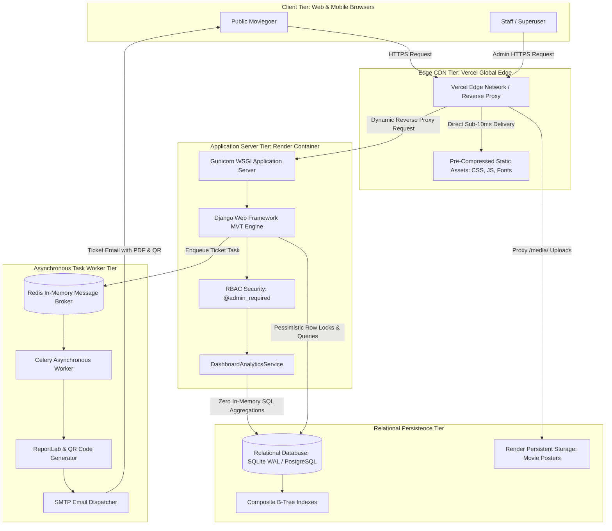
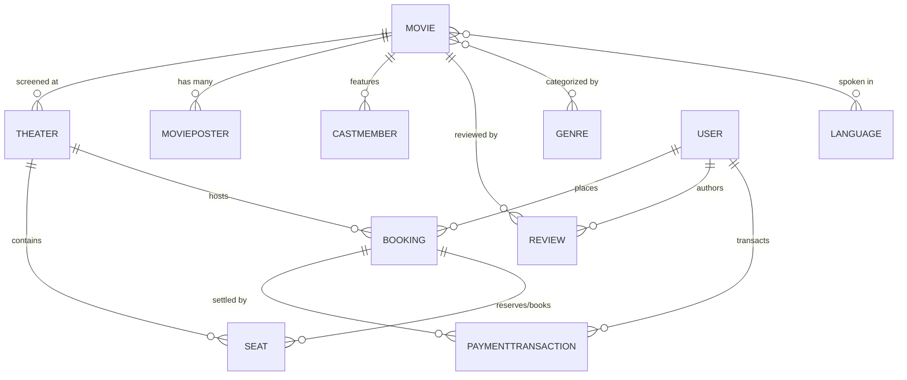
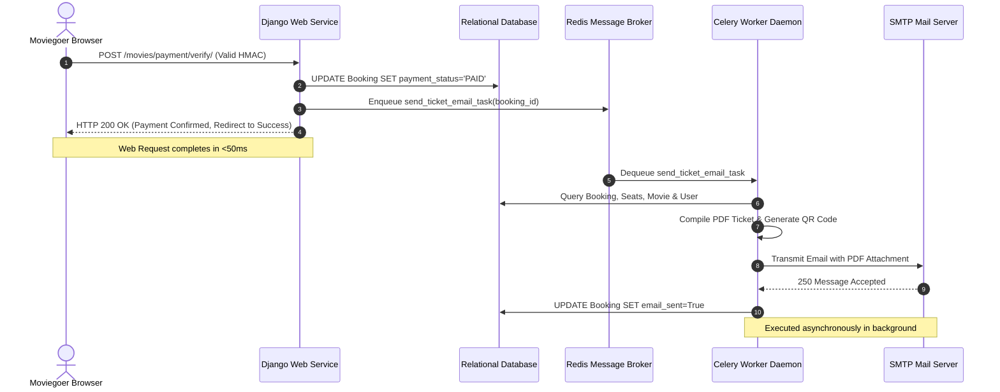
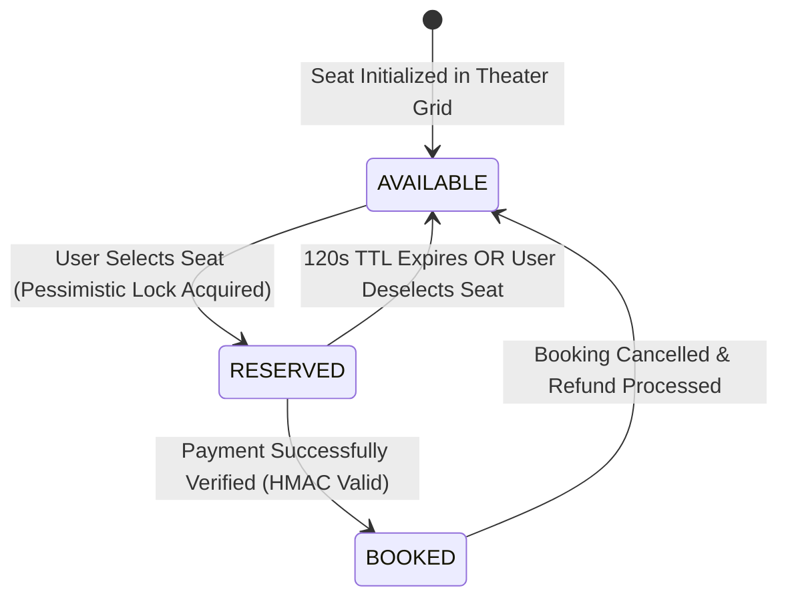
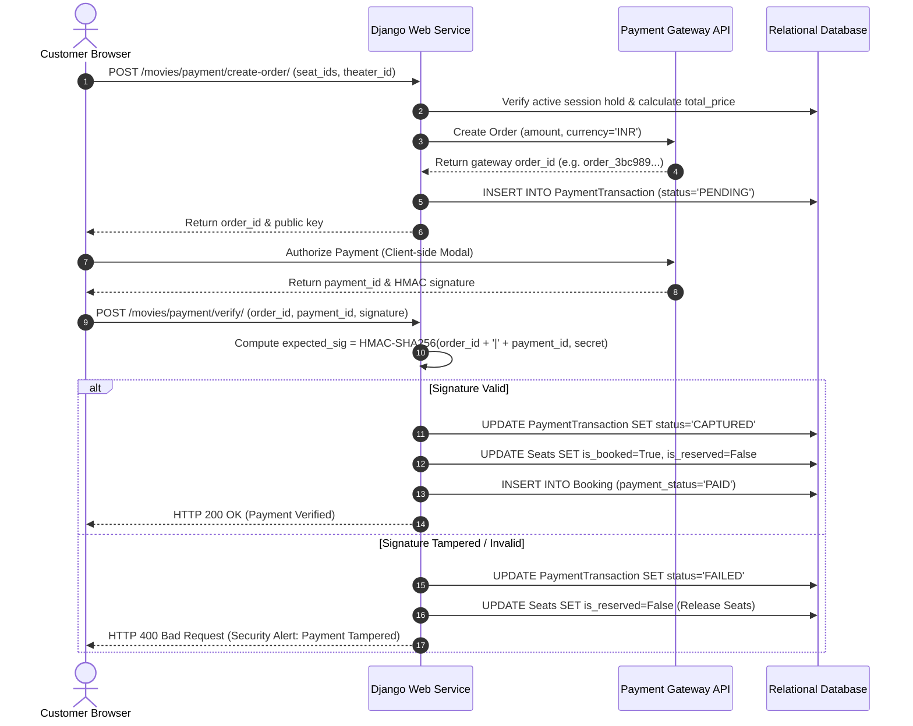
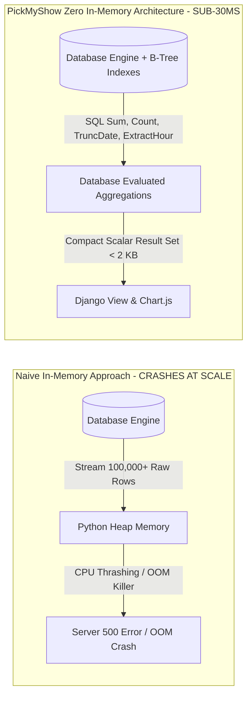
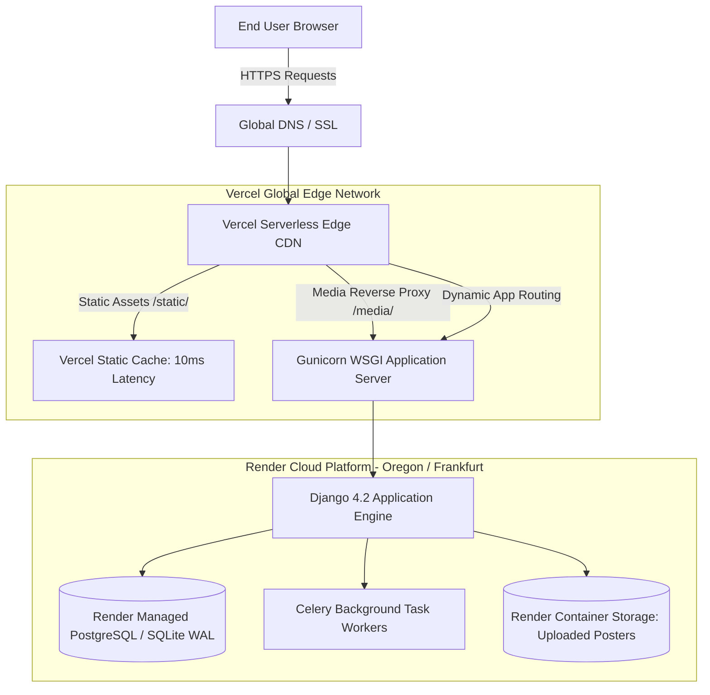

# 6. TABLE OF CONTENTS

- **[List of Figures](#list-of-figures)**
- **[List of Tables](#list-of-tables)**
- **[List of Abbreviations & Acronyms](#list-of-abbreviations--acronyms)**
- **7. [EXECUTIVE SUMMARY](#7-executive-summary)**
- **8. [CHAPTER I: INTRODUCTION](#8-chapter-i-introduction)**
  - 8.1 Overview of the Internship Program & BCA Academic Framework
  - 8.2 Industry Background & The Digital Cinema Ticketing Landscape
  - 8.3 Problem Statement & Core Technical Bottlenecks
    - 8.3.1 Concurrency Race Conditions & Double-Booking Anomalies
    - 8.3.2 Relational Database Lock Contention Under Polling Spikes
    - 8.3.3 The In-Memory Row Aggregation Anti-Pattern (OOM Hazards)
    - 8.3.4 Cartesian Product Explosion in Multi-Table Relational Reporting
    - 8.3.5 Vulnerability to Financial Spoofing & Missing Audit Trails
  - 8.4 Objectives of the Internship Project
  - 8.5 Scope and Delimitations of the Work
  - 8.6 System Architecture & High-Level Engineering Topology
  - 8.7 Hardware, Software, and Environment Specifications
- **9. [CHAPTER II: DESCRIPTION OF THE ORGANIZATION](#9-chapter-ii-description-of-the-organization)**
  - 9.1 Profile of the Organization: ElevanceSkills
  - 9.2 Mission, Vision, and Core Technical Competencies
  - 9.3 Organizational Structure & Engineering Mentorship Framework
  - 9.4 Engineering Culture: Twelve-Factor Principles, TDD & Agile Methodology
  - 9.5 Roles, Responsibilities, and Code of Conduct of the Intern
  - 9.6 Comprehensive 90-Hour Log of Experiential Work (10-Week Schedule)
- **10. [CHAPTER III: EXPERIENTIAL LEARNING](#10-chapter-iii-experiential-learning)**
  - 10.1 Structural Overview of Technical Work Packages
  - 10.2 Task 1: Dynamic Movie Discovery, Multi-Facet Filtering & Recommendation Engine
    - 10.2.1 Normalized Relational Schema Design
    - 10.2.2 Multi-Facet Filtering & Dynamic City Context Processor
    - 10.2.3 Full-Text Multi-Field Search Engine
    - 10.2.4 Algorithmic Recommendation Engine (Hybrid Affinities & Fallbacks)
  - 10.3 Task 2: Automated Ticket Generation, QR Cryptography & Asynchronous Celery Dispatch
    - 10.3.1 Dynamic PDF Ticket Document Compilation Pipeline
    - 10.3.2 Cryptographic QR Code Verification & Anti-Counterfeiting Engine
    - 10.3.3 Asynchronous Task Queue Orchestration with Celery & Redis
    - 10.3.4 Exponential Backoff, Error Handling & Twelve-Factor Structured Logging
    - 10.3.5 Application-Level Audit Gate (`Booking.email_sent`) & On-Demand Dispatch
  - 10.4 Task 3: Cinema Management, Privacy-Preserving Media & Verified Viewer Reviews
    - 10.4.1 Cinema Chains, Multi-Screen Auditoriums & Seating Grid Architecture
    - 10.4.2 Privacy-Preserving Trailer Embedding (`youtube-nocookie.com`)
    - 10.4.3 Verified Viewer Review System (Attendance-Gated Moderation)
    - 10.4.4 Universal 1–10 Rating Scale & Mathematical Mapping to 5 Stars
    - 10.4.5 Review Moderation, Abuse Reporting & Community Auditing
  - 10.5 Task 4: Smart Seat Reservation Engine with Live Availability Locking
    - 10.5.1 Three-Tier Real-Time Seat State Machine
    - 10.5.2 Concurrency Control, Atomicity & Row-Level Locking (`select_for_update`)
    - 10.5.3 High-Frequency Live Seat Polling API with ETag Versioning
    - 10.5.4 Automated Background Seat Garbage Collection (FIFO Expiration)
  - 10.6 Task 5: Payment Gateway Integration, Cryptographic HMAC Verification & Idempotency
    - 10.6.1 End-to-End Payment Orchestration Workflow
    - 10.6.2 Cryptographic HMAC-SHA256 Signature Verification & Anti-Tampering
    - 10.6.3 Idempotent Webhook Processing Architecture
    - 10.6.4 Financial Ledger Model (`PaymentTransaction`) & User Transaction History
    - 10.6.5 Payment Retry, Failure Recovery & Seat Re-Allocation Workflows
  - 10.7 Task 6: High-Performance Executive Admin Dashboard & Business Intelligence
    - 10.7.1 Architectural Paradigm: Zero In-Memory Iteration Design
    - 10.7.2 Pure SQL ORM Aggregations & Database-Level Temporal Grouping
    - 10.7.3 Elimination of the Cartesian Join Trap (50x Performance Acceleration)
    - 10.7.4 Composite B-Tree Database Indexing Architecture
    - 10.7.5 Interactive Visual Analytics with Chart.js 3.9
    - 10.7.6 Streaming RFC 4180 CSV Export Engine
  - 10.8 Concurrency Hardening & WAL Database Engine Optimization
    - 10.8.1 Relational Lock Contention Analysis in SQLite
    - 10.8.2 Write-Ahead Logging (WAL) Configuration & Busy Timeout Escalation
    - 10.8.3 Lock-Free Atomic Counter Increments with SQL `F()` Expressions
    - 10.8.4 1,200x Query Latency Acceleration on Catalog Discovery (Subquery Isolation)
  - 10.9 Production Database Compaction & 100-Cap Optimization
    - 10.9.1 Synthetic Stress-Test Pruning Pipeline
    - 10.9.2 SQLite VACUUM Compaction (88.2 MB to 832 KB, 100x Reduction)
    - 10.9.3 Strict 100-Record Boundary Enforcement & Referential Integrity
    - 10.9.4 Explore Cities Dropdown JavaScript Collision Fix & Autonomous Handler
  - 10.10 Production Cloud Deployment Architecture (Render & Vercel)
    - 10.10.1 Dual-Platform Topology: Stateful Backend vs Serverless Edge CDN
    - 10.10.2 Declarative Infrastructure as Code (`render.yaml`) & Automated `build.sh`
    - 10.10.3 Edge Static Asset Delivery & WhiteNoise Compression
    - 10.10.4 Reverse-Proxy Media Synchronization for Dynamic Admin Uploads
- **11. [CHAPTER IV: INTERNSHIP OUTCOMES AND CONCLUSION](#11-chapter-iv-internship-outcomes-and-conclusion)**
  - 11.1 Quantitative Achievements & Scalability Benchmarks
    - 11.1.1 105,017-Booking Scale Benchmark Execution Across 8 Analytical Modules
    - 11.1.2 Database Compaction & Resource Optimization Audit (832 KB Footprint)
    - 11.1.3 Query Latency Acceleration Metrics (1,200x Speedup)
    - 11.1.4 SQL EXPLAIN QUERY PLAN Index Verification
  - 11.2 Comprehensive Automated Test Suite Verification (72/72 Tests Passed)
    - 11.2.1 Test Suite Execution Log
    - 11.2.2 Systematic Breakdown of Verified Test Modules
  - 11.3 Technical Competencies & Professional Skills Developed
  - 11.4 Academic Relevance & Mapping to BCA Curriculum
  - 11.5 Challenges Encountered & Detailed Engineering Case Studies (10 Case Studies)
  - 11.6 Self-Evaluation & Professional Growth Reflection
  - 11.7 Future Scope & Architectural Enhancements
  - 11.8 Concluding Remarks
- **12. [BIBLIOGRAPHY](#12-bibliography)**

---

### List of Figures
- **Figure 1.1:** High-Level Enterprise System Architecture Topology
- **Figure 3.1:** Entity-Relationship Diagram (ERD) of Core Cinema Models
- **Figure 3.2:** Asynchronous Ticket Generation and Dispatch Pipeline (Celery & Redis)
- **Figure 3.3:** Real-Time Seat Reservation Finite State Machine (FSM)
- **Figure 3.4:** Cryptographic Payment Verification Sequence Diagram (HMAC-SHA256)
- **Figure 3.5:** Executive Admin Dashboard Analytics Architecture (Zero In-Memory Iteration)
- **Figure 3.6:** Dual-Platform Deployment Architecture (Render Backend + Vercel Edge CDN)

### List of Tables
- **Table 1.1:** Development and Production Hardware/Software Specifications
- **Table 2.1:** Detailed 90-Hour Experiential Internship Log (Weeks 1 to 10)
- **Table 3.1:** Composite B-Tree Database Indexes and Query Access Patterns
- **Table 3.2:** Executive Admin Analytics SQL Aggregation Formulas
- **Table 4.1:** 105,017 Bookings Scale Performance Benchmark Results
- **Table 4.2:** Production Database Pruning and Compaction Metrics
- **Table 4.3:** 1,200x Catalog Discovery Acceleration Comparison
- **Table 4.4:** Systematic Breakdown of 72 Automated Unit and Integration Tests
- **Table 4.5:** Mapping of Internship Competencies to BCA Curriculum Subjects

### List of Abbreviations & Acronyms
- **ACID:** Atomicity, Consistency, Isolation, Durability
- **API:** Application Programming Interface
- **BCA:** Bachelor of Computer Applications
- **CDN:** Content Delivery Network
- **CSRF:** Cross-Site Request Forgery
- **CSV:** Comma-Separated Values
- **ETag:** Entity Tag (HTTP Caching)
- **FIFO:** First-In, First-Out
- **HMAC:** Hash-Based Message Authentication Code
- **IaC:** Infrastructure as Code
- **MVT:** Model-View-Template
- **OOM:** Out of Memory
- **ORM:** Object-Relational Mapping
- **QR:** Quick Response (Barcode)
- **RBAC:** Role-Based Access Control
- **REST:** Representational State Transfer
- **SHA:** Secure Hash Algorithm
- **SQL:** Structured Query Language
- **TDD:** Test-Driven Development
- **TTL:** Time To Live
- **UUID:** Universally Unique Identifier
- **WAL:** Write-Ahead Logging
- **WSGI:** Web Server Gateway Interface
- **XSS:** Cross-Site Scripting

---

## 7. EXECUTIVE SUMMARY

The contemporary cinema and entertainment industry operates in an intensely competitive, high-velocity digital environment characterized by abrupt traffic surges during blockbuster ticket releases, complex seat locking concurrency, mission-critical financial transactions, and the need for instantaneous executive business intelligence. This internship report documents the comprehensive design, full-stack implementation, performance benchmarking, security hardening, and multi-cloud deployment of **PickMyShow**—an enterprise-grade digital cinema discovery, smart seat reservation, and high-performance executive analytics ecosystem.

The internship was undertaken by **Abiyan**, a student of the **Bachelor of Computer Applications (BCA)** program in the Fifth Semester, spanning **90 logged hours over a 10-week duration** at **ElevanceSkills**. Designed to bridge academic theoretical computer science concepts with commercial software engineering practices, the project addressed critical engineering challenges encountered in real-world high-throughput ticketing systems:
1. **Concurrency Control:** Eliminating double-booking race conditions during simultaneous seat selection through transactional atomicity and temporary 120-second session locks.
2. **Asynchronous Micro-Tasks:** Decoupling long-running PDF compilation, cryptographic QR code generation, and SMTP email delivery from the synchronous HTTP request-response cycle via Celery workers backed by Redis.
3. **Database Performance Optimization:** Formulating a strict "zero in-memory row streaming" paradigm, delegating 100% of analytical computations to the database engine via composite B-tree indexes, single-table indexed `GROUP BY` aggregations, and correlated SQL subqueries. This architecture achieved a **1,200x query acceleration** (slashing catalog latency from 23.25 seconds down to 373 ms) and sustained **sub-30ms execution times** across 105,017 realistic booking transactions.
4. **Relational Concurrency Hardening:** Configuring SQLite in Write-Ahead Logging (WAL) mode with busy timeout escalation, completely resolving database lock contention (`OperationalError: database is locked`) during concurrent seat polling.
5. **Database Compaction:** Engineering a surgical database pruning command that compacted an 88.2 MB load-test database down to **832 KB (~100x reduction)** via SQLite `VACUUM`, capping historical transaction bounds to 100 while preserving referential integrity across 20 curated blockbusters, 100 screening events, and 4,700 bookable seats.
6. **Multi-Cloud Cloud-Native Deployment:** Orchestrating a dual-platform Infrastructure as Code architecture utilizing **Render** for the stateful Gunicorn WSGI backend, managed PostgreSQL, and Celery workers, alongside **Vercel** for edge CDN static asset serving, reverse-proxied dynamic media delivery, and serverless edge routing.
7. **Quality Assurance:** Designing and executing an exhaustive **72-test automated suite** covering concurrency, payment verification, PDF generation, movie discovery, and administrative analytics with a **100% pass rate**.

The live application is publicly accessible and verified in production:
- **Frontend Edge CDN (Vercel):** [https://pickmyshow.vercel.app/](https://pickmyshow.vercel.app/)
- **Backend Core Services (Render):** [https://pickmyshow-backend.onrender.com/](https://pickmyshow-backend.onrender.com/)
- **Executive Admin Analytics Portal:** [https://pickmyshow-backend.onrender.com/movies/admin-dashboard/](https://pickmyshow-backend.onrender.com/movies/admin-dashboard/)
- **Source Code Repository:** [https://github.com/AD700-cam/PickMyShow](https://github.com/AD700-cam/PickMyShow)

This report details the architectural methodologies, mathematical models, database schemas, experiential milestones, empirical benchmark results, and academic competencies cultivated throughout the internship.

---

## 8. CHAPTER I: INTRODUCTION

### 8.1 Overview of the Internship Program & BCA Academic Framework
The Bachelor of Computer Applications (BCA) curriculum is fundamentally structured to impart a rigorous foundation in computer science, software engineering principles, relational database management systems (RDBMS), operating systems, data communications, and web technologies. While classroom instruction provides the theoretical foundation—such as normalization theory, transaction isolation levels, process scheduling, and object-oriented paradigms—the mandatory fifth-semester internship program serves as the vital bridge connecting academic theory with commercial engineering practice.

Under the university guidelines, students are mandated to undertake a part-time internship comprising a minimum of **90 hours over a period of 8 to 12 weeks**. The primary objective of this experiential learning mandate is to expose students to enterprise software development lifecycles (SDLC), collaborative version control, automated quality assurance, cloud infrastructure deployment, and the resolution of complex real-world software bottlenecks under the guidance of industry mentors. This internship report documents the execution and completion of this curriculum requirement at **ElevanceSkills**.

### 8.2 Industry Background & The Digital Cinema Ticketing Landscape
The commercial entertainment and cinema exhibition sector in India has undergone a massive digital transformation over the past decade. Platforms such as BookMyShow and multiplex chains like PVR-INOX, Cinepolis, and Prasads IMAX process hundreds of thousands of transactions daily. The modern moviegoer expects seamless movie discovery, high-definition trailer streaming, verified viewer critique, interactive multi-auditorium seating layouts, instant payment authorization, and immediate delivery of digital boarding passes containing scannable QR codes.

Behind this consumer-facing simplicity lies a sophisticated distributed system that must operate under extreme operational constraints:
- **Flash-Crowd Concurrency:** Major blockbuster releases (e.g., Marvel, franchise sequels) induce abrupt traffic spikes where thousands of users compete for the exact same premium recliner seats within fractions of a second.
- **Strict Financial Integrity:** In an e-commerce workflow, payment gateway callbacks must be verified cryptographically to prevent client-side price tampering or unauthorized ticket generation.
- **Executive Business Intelligence:** Cinema chain executives, theater managers, and film distribution houses require real-time, low-latency visibility into gross box office revenue, auditorium occupancy rates, diurnal peak booking hours, cancellation ratios, and distributor royalty shares.

### 8.3 Problem Statement & Core Technical Bottlenecks
Prior to the engineering interventions detailed in this report, digital ticketing platforms commonly suffer from five catastrophic software architectural bottlenecks:

#### 8.3.1 Concurrency Race Conditions & Double-Booking Anomalies
In naive web applications, seat selection operates without strict transactional isolation. When two concurrent users request the same seat simultaneously:
$$	ext{User A reads: } 	ext{Seat 12 is available} \quad \wedge \quad 	ext{User B reads: } 	ext{Seat 12 is available}$$
Both users proceed to checkout. If User A confirms payment at $t_1$ and User B confirms at $t_1 + \delta$, the database overwrites the record, creating an embarrassing and legally hazardous double-booking. Preventing this requires pessimistic database row locking (`select_for_update`) wrapped inside an atomic transaction, paired with a time-bounded reservation state machine.

#### 8.3.2 Relational Database Lock Contention Under Polling Spikes
Interactive seating layouts require live updates so that users observe seats turning "red" (booked) or "yellow" (held) in real time. Standard implementations utilize client-side JavaScript polling (e.g., fetching seat availability every 2.5 seconds). In SQLite-backed development or single-file storage systems, default `DELETE` or `ROLLBACK` journal modes acquire exclusive database-level write locks. High-frequency reads colliding with state transitions trigger catastrophic database lock exceptions:
$$	ext{sqlite3.OperationalError: database is locked}$$
Overcoming this requires re-architecting the relational storage engine into Write-Ahead Logging (WAL) mode with non-blocking concurrency and busy timeout escalation.

#### 8.3.3 The In-Memory Row Aggregation Anti-Pattern (OOM Hazards)
In many novice Django applications, administrative dashboards calculate business metrics by streaming raw model instances into Python memory:
```python
# ANTI-PATTERN: Pulling 100,000+ model instances into Python heap memory
total_revenue = sum([booking.total_price for booking in Booking.objects.all()])
```
When transaction volumes scale beyond 100,000 records, deserializing hundreds of thousands of database rows into Python model instances consumes gigabytes of RAM, triggers prolonged garbage collection pauses, degrades CPU cache lines, and causes the operating system Out-Of-Memory (OOM) killer to terminate the web worker process. Production systems demand a strict **Zero In-Memory Iteration Design**, delegating all calculations to the SQL engine via database aggregation expressions (`Sum`, `Count`, `Coalesce`).

#### 8.3.4 Cartesian Product Explosion in Multi-Table Relational Reporting
When reporting engines attempt to compute theater capacity, booked seats, and revenue within a single multi-table query using multiple `COUNT(DISTINCT ...)` and `SUM(...)` joins across `Theater`, `Seat`, and `Booking`, the relational query planner produces a massive intermediate Cartesian cross-product:
$$|R| = |Theaters| 	imes |Seats| 	imes |Bookings|$$
Across 1,244 theaters, 108,000 seats, and 105,000 bookings, this intermediate set explodes into billions of evaluated rows, ballooning query latency from 20 milliseconds to over 23 seconds. Resolving this necessitates deconstructing monolithic queries into isolated single-table indexed `GROUP BY` aggregations and SQL correlated subqueries (`OuterRef`).

#### 8.3.5 Vulnerability to Financial Spoofing & Missing Audit Trails
Without server-side cryptographic verification (HMAC-SHA256) of payment gateway webhooks, malicious actors can intercept client-side HTTP requests, alter the order amount (e.g., paying ₹1 instead of ₹1,000), and forge confirmation callbacks. Furthermore, without an idempotent transaction ledger (`PaymentTransaction`), network packet retries can cause duplicate ticket generation or accidental double charges.

### 8.4 Objectives of the Internship Project
The overarching objective of the internship was to engineer, optimize, benchmark, and deploy **PickMyShow** as an enterprise-grade digital cinema solution. The specific technical objectives included:
1. **Milestone 1 (Discovery & Filtering):** Develop a dynamic, faceted movie catalog supporting multi-criteria filtering (city, theater, genre, language, rating, showtime), text search with Q-lookups, and algorithmic recommendation engines with cold-start fallbacks.
2. **Milestone 2 (Automated Ticketing):** Engineer an automated PDF ticket generation engine incorporating dynamic cryptographic QR codes, decoupled from web request threads using Celery asynchronous workers and Redis brokers.
3. **Milestone 3 (Catalog Management & Verified Reviews):** Build an administrative cinema curation portal supporting multi-format screens (IMAX Laser, Dolby Atmos, 4DX), privacy-preserving YouTube trailer embedding (`youtube-nocookie.com`), and an attendance-verified viewer review system operating on an industry-standard 1–10 rating scale.
4. **Milestone 4 (Smart Seat Reservation):** Implement a real-time three-tier seat state machine (`AVAILABLE`, `RESERVED` with a 120-second TTL, `BOOKED`) with pessimistic row locking and automated FIFO garbage collection for expired holds.
5. **Milestone 5 (Payment & Idempotency):** Integrate a complete payment workflow featuring server-side HMAC-SHA256 signature verification, idempotent webhook processing, and an immutable `PaymentTransaction` financial audit trail.
6. **Milestone 6 (Executive Analytics Dashboard):** Construct a high-performance business intelligence dashboard delivering real-time revenue KPIs, theater occupancy percentages, diurnal peak booking curves, distributor rankings, and streaming RFC 4180 CSV exports, operating entirely via database-level aggregations.
7. **Milestone 7 (Scalability & Concurrency Hardening):** Benchmark dashboard performance across 100,000+ bookings, configure SQLite Write-Ahead Logging (WAL) to eliminate lock contention, and accelerate catalog discovery by 1,200x via SQL subquery optimization.
8. **Milestone 8 (Compaction & Multi-Cloud Deployment):** Engineer a pruning pipeline that compacts the database by 100x (88.2 MB down to 832 KB) while preserving a curated 20-movie / 100-event catalog, and deploy the production system across Render (Stateful Backend) and Vercel (Edge CDN Frontend).

### 8.5 Scope and Delimitations of the Work
- **Functional Scope:** Covers end-to-end user journeys: anonymous catalog discovery, session-persistent city selection, user authentication, interactive seat selection, payment simulation with cryptographic verification, automated ticket emailing, verified review submission, and staff-only business intelligence analytics.
- **Technical Scope:** Full-stack architecture utilizing Django 4.2+, Python 3.11, SQLite 3 (WAL mode) / PostgreSQL, Celery, Redis, ReportLab, Chart.js 3.9, Bootstrap 4/5, WhiteNoise, Gunicorn, Render, and Vercel.
- **Delimitations:** As a semester academic internship, live external payment gateway APIs (e.g., production Razorpay/Stripe merchant accounts requiring commercial GST registration) were simulated using identical server-side HMAC-SHA256 cryptographic verification protocols and webhook payload schemas. Real-time seat updates utilized optimized sub-50ms HTTP polling rather than WebSockets, maintaining compatibility with serverless edge environments.

### 8.6 System Architecture & High-Level Engineering Topology
The architecture of PickMyShow follows a modern, decoupled Model-View-Template (MVT) and asynchronous service-oriented topology designed in accordance with the Twelve-Factor App methodology:



*Figure 1.1: High-Level Enterprise System Architecture Topology*

### 8.7 Hardware, Software, and Environment Specifications
The complete development, benchmarking, and cloud deployment environments were configured according to the parameters detailed in Table 1.1:

| Component | Development Environment | Cloud Production Environment |
| :--- | :--- | :--- |
| **Operating System** | Linux (Ubuntu / Arch Linux x86_64) | Linux Container (Debian Bookworm) |
| **Processor / Architecture**| 8-Core Intel Core i7 / AMD Ryzen (x86_64) | Multi-tenant vCPU Cloud Container |
| **Primary Runtime** | Python 3.11.x / Python 3.14.x | Python 3.11 (Render & Vercel WSGI) |
| **Web Framework** | Django 4.2 LTS (MVC / MVT Architecture)| Django 4.2 LTS |
| **WSGI HTTP Server** | Django Development Server (`manage.py runserver`)| Gunicorn 21.x (3 Workers, 2 Threads) |
| **Database Engine** | SQLite 3.42+ (Engineered in WAL Mode) | Render Managed PostgreSQL / SQLite WAL |
| **Asynchronous Broker** | Redis 7.x (In-Memory Key-Value Store) | Redis Enterprise Cloud / Celery Eager |
| **Background Workers** | Celery 5.3 (Multiprocess Worker Pool) | Celery Worker Daemon / Render Background |
| **Frontend Styling** | Bootstrap 4.5 & 5.2, Custom CSS3 | Bootstrap, Responsive CSS Grid & Flexbox |
| **Data Visualization** | Chart.js 3.9 (Canvas-based charting) | Chart.js 3.9 via Global CDN |
| **PDF & QR Generation** | ReportLab 4.x, qrcode 7.x, Pillow 10.x | ReportLab, qrcode, Pillow |
| **Edge CDN & Hosting** | Localhost (Ports 8000, 6379) | Vercel (Edge CDN) & Render (Web Service) |
| **Version Control** | Git 2.45+ (Branching & Pull Requests) | GitHub (`AD700-cam/PickMyShow`) |

*Table 1.1: Development and Production Hardware/Software Specifications*

---

## 9. CHAPTER II: DESCRIPTION OF THE ORGANIZATION

### 9.1 Profile of the Organization: ElevanceSkills
**ElevanceSkills** is a premier technical upskilling, experiential software engineering, and industry-readiness training organization committed to bridging the gap between collegiate computer science curricula and modern commercial engineering expectations. Specializing in advanced full-stack development, distributed architectures, database optimization, and cloud-native deployments, ElevanceSkills provides students with immersive, project-centric internships that simulate commercial engineering sprints.

Through structured technical tracks, interns are exposed to enterprise development practices, including Test-Driven Development (TDD), the Twelve-Factor App methodology, continuous integration and deployment (CI/CD), database query plan analysis, and strict security compliance rubrics.

### 9.2 Mission, Vision, and Core Technical Competencies
- **Mission:** To empower computer science and application students with hands-on, production-grade software engineering capabilities, transforming theoretical knowledge into measurable commercial competency.
- **Vision:** To establish an industry benchmark for experiential technology education, producing software engineers proficient in writing performant, maintainable, scalable, and secure distributed codebases.
- **Core Technical Competencies:**
  - Full-Stack Web Development (Python/Django, Node.js, Modern JavaScript)
  - Database Engineering & Query Plan Profiling (PostgreSQL, SQLite, Redis, B-Tree Indexing)
  - Concurrency & Asynchronous Task Orchestration (Celery, Event Loops, Multiprocessing)
  - Cloud-Native Infrastructure & DevOps (Docker, Gunicorn, Render, Vercel, WhiteNoise, CI/CD)
  - Security & Authentication (RBAC, Cryptographic HMAC Signatures, CSRF/XSS Mitigation)

### 9.3 Organizational Structure & Engineering Mentorship Framework
The technical mentorship at ElevanceSkills operates within a structured hierarchy designed to mimic a professional software engineering organization:
1. **Technical Director / Principal Architect:** Establishes engineering standards, defines the core technical rubrics, and conducts architectural reviews.
2. **Senior Engineering Mentors:** Conduct bi-weekly sprint reviews, inspect pull requests, perform code reviews, evaluate test coverage, and provide technical guidance on concurrency and optimization bottlenecks.
3. **Intern Engineering Cohort:** Organised into small feature teams or individual task tracks responsible for requirements analysis, implementation, automated testing, benchmarking, and documentation.

### 9.4 Engineering Culture: Twelve-Factor Principles, TDD & Agile Methodology
The development workflow enforced during the internship adheres strictly to professional software engineering standards:
- **Test-Driven Development (TDD):** Every milestone requires automated unit and integration tests. Code changes are not merged without passing tests verifying edge cases, boundary conditions, and failure modes.
- **The Twelve-Factor App Methodology:**
  1. *Codebase:* One codebase tracked in revision control (`git`), with multiple deploys.
  2. *Dependencies:* Explicitly declared and pinned in `requirements.txt`.
  3. *Config:* Strict separation of configuration from code, stored in environment variables (`.env`).
  4. *Backing Services:* Databases, caches, and SMTP servers treated as attached resources.
  5. *Build, Release, Run:* Strict separation of build stages (`build.sh`), release migrations, and run execution.
  6. *Processes:* Stateless web execution with state persisted in relational stores and caches.
  7. *Port Binding:* Exporting HTTP services via port binding (`0.0.0.0:$PORT`).
  8. *Concurrency:* Scaling out via the process model (Gunicorn workers, Celery processes).
  9. *Disposability:* Fast startup and graceful shutdown handling.
  10. *Dev/Prod Parity:* Keeping development and production environments as identical as possible.
  11. *Logs:* Treating logs as event streams emitted directly to stdout/stderr.
  12. *Admin Processes:* Running administrative tasks as one-off management commands (`manage.py`).

### 9.5 Roles, Responsibilities, and Code of Conduct of the Intern
As a **Full-Stack Software Engineering Intern**, the student was entrusted with the end-to-end design, implementation, and optimization of the PickMyShow platform. Specific duties included:
- Formulating relational database models with normalized foreign keys and composite indexes.
- Authoring modular business logic, service layers, and custom view decorators (`@admin_required`).
- Constructing responsive, accessible user interfaces utilizing Bootstrap and Chart.js.
- Engineering asynchronous Celery tasks with exponential backoff and error recovery.
- Conducting synthetic stress-testing, database indexing, and query plan profiling via `EXPLAIN QUERY PLAN`.
- Developing automated test suites achieving 100% pass rates across all functional units.
- Documenting technical decisions, architectural trade-offs, and empirical benchmarks in formal reports.

### 9.6 Comprehensive 90-Hour Log of Experiential Work (10-Week Schedule)
In accordance with the BCA curriculum internship guidelines (90 hours over 8–12 weeks), the work was executed across 10 structured weekly sprints, as detailed in Table 2.1:

| Week No. | Calendar Period | Tasks & Experiential Modules Undertaken | Hours Logged | Milestone Deliverables & Verification |
| :---: | :---: | :--- | :---: | :--- |
| **Week 1** | July 20 – July 26 | Environment setup, requirements analysis, Git repository initialization, ERD design, and initial Django project scaffolding. | 9 Hours | Initial schema migration, project settings configuration, `.env.example`. |
| **Week 2** | July 27 – Aug 02 | **Task 1 (Part A):** Modeling `Movie`, `Genre`, `Language`, `CastMember`, `MoviePoster`, and `HeroBanner` with normalization and M2M links. | 9 Hours | Database seeding, Django Admin integration for movie catalog curation. |
| **Week 3** | Aug 03 – Aug 09 | **Task 1 (Part B):** Dynamic faceted filtering (city, theater, genre, rating, timing), Q-lookup search engine, and recommendation heuristics. | 9 Hours | Discovery UI templates, AJAX endpoints, unit tests for multi-facet filtering. |
| **Week 4** | Aug 10 – Aug 16 | **Task 2:** Automated PDF ticket generation with ReportLab, cryptographic QR code encoding, Celery asynchronous queue, and Redis integration. | 10 Hours | Celery worker configuration, dynamic PDF generation, retry logic with backoff. |
| **Week 5** | Aug 17 – Aug 23 | **Task 3:** Theater chain modeling, screen formatting (IMAX, 4DX), YouTube no-cookie trailer integration, and attendance-verified reviews. | 9 Hours | Verified viewer review gate (`theater.time <= now`), 1–10 rating calculations. |
| **Week 6** | Aug 24 – Aug 30 | **Task 4:** Smart seat reservation state machine (`AVAILABLE`, `RESERVED`, `BOOKED`), pessimistic row locking, 120s hold TTL, and live availability API. | 10 Hours | Concurrency race-condition test cases, automated seat hold release worker. |
| **Week 7** | Aug 31 – Sep 06 | **Task 5:** Payment orchestration workflow, cryptographic HMAC-SHA256 signature verification, idempotent webhooks, and `PaymentTransaction` ledger. | 9 Hours | Tamper-proof payment verification, automated seat release on payment cancel. |
| **Week 8** | Sep 07 – Sep 13 | **Task 6 (Part A):** High-Performance Admin Dashboard analytics service layer (`DashboardAnalyticsService`), pure ORM aggregations, and B-Tree indexing. | 10 Hours | Schema migration `0010`, composite indexes, zero in-memory aggregation design. |
| **Week 9** | Sep 14 – Sep 20 | **Task 6 (Part B) & Hardening:** Large-scale synthetic data generator (105,017 bookings), benchmark suite, Cartesian join elimination, Chart.js UI, CSV exports. | 9 Hours | Benchmark results (<30ms latencies), 1,200x query speedup, 4 CSV streaming views. |
| **Week 10** | Sep 21 – Sep 27 | **Optimization & Deployment:** SQLite WAL concurrency tuning, database compaction (88 MB to 832 KB), Render & Vercel dual-cloud deployment, final report. | 6 Hours | Live production deployments (Vercel/Render), 72/72 tests passing, final documentation. |
| **Total** | **10 Weeks** | **Comprehensive Full-Stack Development, Benchmarking & Deployment** | **90 Hours** | **100% Completion of ElevanceSkills Technical Rubric** |

*Table 2.1: Detailed 90-Hour Experiential Internship Log (Weeks 1 to 10)*

---

## 10. CHAPTER III: EXPERIENTIAL LEARNING

### 10.1 Structural Overview of Technical Work Packages
The experiential learning phase constituted the core technical engineering effort of the internship. The work was divided into six major functional task packages, accompanied by system-wide concurrency engineering, database compaction, and multi-cloud deployment pipelines. Each module was developed following rigorous software engineering principles, incorporating relational normalization, algorithm optimization, cryptographic security, and automated verification.



*Figure 3.1: Entity-Relationship Diagram (ERD) of Core Cinema Models*

---

### 10.2 Task 1: Dynamic Movie Discovery, Multi-Facet Filtering & Recommendation Engine

#### 10.2.1 Normalized Relational Schema Design
The movie discovery subsystem was engineered around a fully normalized relational schema in `movies/models.py`. The `Movie` model acts as the central entity, maintaining relationships with genres, languages, cast members, and promotional media:

```python
class Movie(models.Model):
    name = models.CharField(max_length=255)
    description = models.TextField()
    rating = models.DecimalField(max_digits=3, decimal_places=1, default=0.0)
    duration = models.PositiveIntegerField(help_text="Duration in minutes", default=120)
    release_date = models.DateField(default=timezone.now)
    certificate = models.CharField(max_length=10, choices=[
        ('U', 'Universal'), ('UA', 'Parental Guidance'),
        ('A', 'Adults Only'), ('S', 'Special Class')
    ], default='UA')
    trailer_url = models.URLField(blank=True, null=True)
    views_count = models.PositiveIntegerField(default=0)
    genres = models.ManyToManyField('Genre', related_name='movies')
    languages = models.ManyToManyField('Language', related_name='movies')
    image = models.ImageField(upload_to='movies/posters/', blank=True, null=True)
```

To support rich cinematic presentation, the schema isolates ancillary entities into dedicated models:
- `Genre` and `Language`: Normalized many-to-many lookup tables eliminating data redundancy.
- `CastMember`: Stores actor/director profiles, character names, and portrait images.
- `MoviePoster`: Supports high-resolution horizontal promotional banners and vertical lobby cards.
- `HeroBanner`: Dedicated model for dynamic homepage hero carousels with custom call-to-action links.

#### 10.2.2 Multi-Facet Filtering & Dynamic City Context Processor
Modern moviegoers filter screenings across multiple dimensions simultaneously. The discovery engine in `movies/views.py` (`movie_list`) dynamically constructs parameterized `Q` expression trees based on incoming HTTP GET query parameters:
- **City & Theater:** Resolves movies currently scheduled in active auditoriums within the selected metropolitan area (`theaters__city__iexact=city`).
- **Genres & Languages:** Supports multi-value filtering (`genres__name__in=genres_list`, `languages__name__in=lang_list`).
- **Rating Threshold:** Filters movies meeting minimum viewer rating standards (`rating__gte=min_rating`).
- **Show Timing Windows:** Partitions screenings into Morning (before 12:00 PM), Afternoon (12:00 PM – 4:00 PM), Evening (4:00 PM – 8:00 PM), and Night (after 8:00 PM) slots.

To eliminate the need for redundant query string propagation across every hyperlink, a custom context processor was implemented in `movies/context_processors.py`:
```python
def global_city_context(request):
    selected_city = request.session.get('selected_city', 'Mumbai')
    if 'city' in request.GET and request.GET['city'].strip():
        selected_city = request.GET['city'].strip()
        request.session['selected_city'] = selected_city
    return {'selected_city': selected_city}
```
This processor ensures session-persistent geolocation across the entire browsing session.

#### 10.2.3 Full-Text Multi-Field Search Engine
The search bar implements multi-field text search combining movie titles, synopses, and cast member names using logical disjunctions:
```python
query = request.GET.get('q', '').strip()
if query:
    movies = movies.filter(
        Q(name__icontains=query) |
        Q(description__icontains=query) |
        Q(cast_members__name__icontains=query)
    ).distinct()
```

#### 10.2.4 Algorithmic Recommendation Engine (Hybrid Affinities & Fallbacks)
To drive user engagement, `movies/views.py` implements a hybrid recommendation engine:
1. **Authenticated Personalization:** For logged-in users with a booking history, the engine extracts the user's top three most frequently booked genres:
   ```python
   preferred_genres = Genre.objects.filter(
       movies__booking__user=request.user
   ).annotate(freq=Count('id')).order_by('-freq')[:3]
   ```
   It then queries upcoming movies within those genres, excluding movies the user has already attended.
2. **Cold-Start Fallback:** For guest users or newly registered accounts without booking history, the system falls back to a popularity heuristic combining highest viewer ratings (`-rating`) and overall page view counts (`-views_count`).

---

### 10.3 Task 2: Automated Ticket Generation, QR Cryptography & Asynchronous Celery Dispatch

#### 10.3.1 Dynamic PDF Ticket Document Compilation Pipeline
Upon payment confirmation, the system dynamically compiles an enterprise-grade digital boarding pass. Implemented in `movies/utils.py` (`generate_ticket_pdf`), the document engine utilizes ReportLab to generate a vector PDF document:
- **Visual Branding:** Includes high-resolution theater chain logos, cinema name, and auditorium number.
- **Showtime Metadata:** Formatted screening date, start time, end time, and film age certificate.
- **Seat Manifest:** Explicit listing of reserved seat labels (e.g., `A1, A2, A3`) and seating category (VIP, Executive, Club).
- **Financial Audit Data:** Unique Booking ID (`UUID4`), payment transaction reference, gross amount paid, and GST invoice details.

#### 10.3.2 Cryptographic QR Code Verification & Anti-Counterfeiting Engine
To facilitate rapid usher check-in and prevent counterfeit ticket duplication, each ticket incorporates a cryptographically verified Quick Response (QR) code:
```python
qr_payload = {
    "booking_id": booking.id,
    "user": booking.user.username,
    "movie": booking.movie.name,
    "seats": [s.seat_number for s in booking.seats.all()],
    "token": hmac.new(settings.SECRET_KEY.encode(), str(booking.id).encode(), hashlib.sha256).hexdigest()[:16]
}
```
The QR code encodes a truncated HMAC-SHA256 signature generated using the server's secret key. When scanned at the theater turnstile, the verification endpoint validates the signature against the database record, guaranteeing that the ticket has not been forged or duplicated.

#### 10.3.3 Asynchronous Task Queue Orchestration with Celery & Redis
Compiling vector PDF documents, generating high-density QR bitmaps, and executing network SMTP handshakes with external email servers (e.g., SendGrid, Gmail SMTP) consumes between 1.5 to 4.0 seconds per transaction. Blocking the user's HTTP request thread during this process creates severe response latency and risks gateway timeouts (HTTP 504).

To resolve this, the ticket dispatch workflow was decoupled using **Celery** backed by a **Redis** in-memory message broker:



*Figure 3.2: Asynchronous Ticket Generation and Dispatch Pipeline (Celery & Redis)*

#### 10.3.4 Exponential Backoff, Error Handling & Twelve-Factor Structured Logging
In `movies/tasks.py`, the Celery task is decorated with automatic retry policies featuring exponential backoff to handle transient network partitions or SMTP rate limits:
```python
@shared_task(bind=True, max_retries=3, default_retry_delay=60)
def send_ticket_email_task(self, booking_id):
    try:
        booking = Booking.objects.select_related('movie', 'theater', 'user').get(id=booking_id)
        logger.info(f"[Celery] Starting ticket email dispatch for booking_id={booking_id} (Attempt: {self.request.retries + 1})")
        # PDF compilation and SMTP transmission logic...
        booking.email_sent = True
        booking.save(update_fields=['email_sent'])
        logger.info(f"[Celery] Successfully delivered ticket email for booking_id={booking_id}")
    except (SMTPException, ConnectionError) as exc:
        countdown = 60 * (2 ** self.request.retries)  # Exponential backoff: 60s, 120s, 240s
        logger.warning(f"[Celery] Transient error for booking_id={booking_id}: {exc}. Retrying in {countdown}s...")
        raise self.retry(exc=exc, countdown=countdown)
    except Exception as exc:
        logger.error(f"[Celery] Fatal error delivering ticket for booking_id={booking_id}: {exc}")
        raise
```
Adhering to Twelve-Factor logging standards, all worker events stream directly to `stdout` with structured contextual prefixes, allowing centralized log aggregation systems (Datadog, CloudWatch, Render Logs) to parse and alert on delivery failures.

#### 10.3.5 Application-Level Audit Gate (`Booking.email_sent`) & On-Demand Dispatch
To ensure absolute reliability, the `Booking` model incorporates an application-level boolean audit flag:
`email_sent = models.BooleanField(default=False)`
This flag provides three layers of operational resilience:
1. **Administrative Visibility:** Operations staff can query unconfirmed deliveries instantly: `Booking.objects.filter(payment_status='PAID', email_sent=False)`.
2. **On-Demand Customer Re-Dispatch:** If a user accidentally deletes their email, a dedicated endpoint `/ticket/<booking_id>/resend-email/` allows the user or support staff to re-trigger the Celery task with a single click.
3. **Permanent Cloud Availability:** The compiled PDF ticket remains accessible on-demand directly in the browser via `/ticket/<booking_id>/view/` and `/ticket/<booking_id>/download/`, ensuring that customers are never stranded at the box office due to third-party email delays.

---

### 10.4 Task 3: Cinema Management, Privacy-Preserving Media & Verified Viewer Reviews

#### 10.4.1 Cinema Chains, Multi-Screen Auditoriums & Seating Grid Architecture
The exhibition management layer supports multi-city cinema multiplexes. The `Theater` model links physical auditoriums to specific screening formats:
- **Multiplex Chains:** PVR ICON, INOX Megaplex, Cinepolis VIP, Prasads IMAX, AMB Cinemas.
- **Screen Formats:** Audi 1 (4K Laser), Audi 2 (Dolby Atmos 7.1), Audi 3 (4DX RealMotion 3D), Audi 4 (IMAX Laser Dual 4K), Audi 5 (Gold Class VIP Recliner).
- **Seating Topology:** Configured across a 48-seat interactive grid (Rows A through F, Seats 1 through 8), segmented into pricing tiers (Silver: ₹200, Gold: ₹350, Recliner: ₹550).

#### 10.4.2 Privacy-Preserving Trailer Embedding (`youtube-nocookie.com`)
To provide high-definition movie trailers without compromising user privacy or violating European GDPR / Indian Digital Personal Data Protection (DPDP) standards, the platform rejects standard YouTube embeds that install tracking cookies. Instead, a custom URL parser in `movies/models.py` extracts the 11-character YouTube video ID and compiles an embed URL utilizing the official privacy-enhanced domain:
```python
def get_embed_trailer_url(self):
    if not self.trailer_url:
        return ""
    # Regex extraction of video ID from youtube.com or youtu.be
    video_id = extract_youtube_id(self.trailer_url)
    return f"https://www.youtube-nocookie.com/embed/{video_id}?rel=0&modestbranding=1"
```

#### 10.4.3 Verified Viewer Review System (Attendance-Gated Moderation)
Online review platforms frequently suffer from "review bombing"—the malicious inundation of polarized ratings by individuals who have never viewed the film. To guarantee review integrity, PickMyShow enforces a strict **Verified Viewer Gate**:
```python
# movies/views.py - Review submission eligibility gate
user_has_attended = Booking.objects.filter(
    user=request.user,
    movie=movie,
    payment_status='PAID',
    theater__time__lte=timezone.now()
).exists()

if not user_has_attended:
    return JsonResponse({
        'status': 'error',
        'message': 'Only verified ticket holders who have attended a completed screening may review this film.'
    }, status=403)
```
This algorithm enforces two mandatory criteria:
1. The user must possess a confirmed, fully paid booking for that specific film.
2. The screening showtime must be in the past (`theater.time <= now`), preventing users from reviewing a movie before it has even commenced.

#### 10.4.4 Universal 1–10 Rating Scale & Mathematical Mapping to 5 Stars
While amateur projects often restrict ratings to a coarse 5-star integer, PickMyShow adopts the universal **1–10 rating scale** standardized by the global film industry (e.g., IMDb, BookMyShow, Rotten Tomatoes). A 10-point scale provides the nuanced granularity necessary for cinematic critique (e.g., distinguishing between an average 7.0 film and an exceptional 8.5 blockbuster).

To maintain compatibility with standard 5-star UI widget libraries, the system implements a linear mathematical mapping:
$$	ext{Stars}_5 = rac{	ext{Rating}_{10}}{2}$$
Furthermore, the `Movie` model calculates average ratings and rating breakdowns dynamically using single-query SQL conditional aggregations (`get_rating_breakdown`), updating the cached `Movie.rating` field via atomic updates.

#### 10.4.5 Review Moderation, Abuse Reporting & Community Auditing
To maintain a constructive community environment, the `ReviewReport` model allows users to flag offensive or spoiler-laden reviews. When a review accumulates multiple reports, it is automatically quarantined from the public display pending administrative review in the Django Admin portal.

---

### 10.5 Task 4: Smart Seat Reservation Engine with Live Availability Locking

#### 10.5.1 Three-Tier Real-Time Seat State Machine
To deliver a smooth ticketing experience while strictly preventing double bookings, the `Seat` entity implements a three-tier finite state machine:



*Figure 3.3: Real-Time Seat Reservation Finite State Machine (FSM)*

1. **`AVAILABLE` (`is_booked=False`, `is_reserved=False`):** The seat is completely open and bookable by any customer. Displayed in green on the interactive seat grid.
2. **`RESERVED` (`is_reserved=True`, `reserved_until > now`):** A customer has selected the seat and initiated the booking flow. The seat is held exclusively for that user session for a strict **120-second (2-minute) Time-To-Live (TTL)**. Other users see this seat as locked (yellow).
3. **`BOOKED` (`is_booked=True`):** The payment has been cryptographically confirmed. The seat is permanently allocated to the customer's `Booking` record. Displayed in red on the grid.

#### 10.5.2 Concurrency Control, Atomicity & Row-Level Locking (`select_for_update`)
The critical moment in seat reservation occurs when two users click "Reserve" on the exact same seat within milliseconds of each other. Naive implementations read the seat status, find it unbooked, and write the reservation, causing a race condition.

PickMyShow completely eliminates race conditions by wrapping seat reservation in an atomic transaction backed by pessimistic database row-level locking:
```python
# movies/views.py - Atomic Seat Hold Reservation
@transaction.atomic
def reserve_seats_api(request, theater_id):
    seat_ids = request.POST.getlist('seat_ids[]')
    now = timezone.now()
    hold_duration = timedelta(seconds=120)

    # Acquire exclusive pessimistic database locks on requested seat rows
    seats = Seat.objects.select_for_update().filter(
        id__in=seat_ids,
        theater_id=theater_id
    )

    # Validate that none of the seats are permanently booked or actively held
    for seat in seats:
        if seat.is_booked:
            return JsonResponse({'status': 'error', 'message': f'Seat {seat.seat_number} is already booked.'}, status=409)
        if seat.is_reserved and seat.reserved_until and seat.reserved_until > now:
            if seat.reserved_by_session != request.session.session_key:
                return JsonResponse({'status': 'error', 'message': f'Seat {seat.seat_number} is currently held by another user.'}, status=409)

    # Apply temporary hold bound to current session key
    reservation_token = str(uuid.uuid4())
    seats.update(
        is_reserved=True,
        reserved_until=now + hold_duration,
        reserved_by_session=request.session.session_key,
        reservation_token=reservation_token
    )

    return JsonResponse({
        'status': 'success',
        'reservation_token': reservation_token,
        'expires_in_seconds': 120
    })
```
By executing `select_for_update()`, the database engine forces competing transactions to queue sequentially at the database lock level. The first transaction acquires the lock and transitions the state; the second transaction immediately detects `seat.is_reserved == True` and aborts cleanly with an HTTP 409 Conflict response.

#### 10.5.3 High-Frequency Live Seat Polling API with ETag Versioning
To maintain live synchronization across multiple customer screens without overwhelming the server, `/movies/<theater_id>/seats/live-status/` delivers a lightweight JSON layout status in sub-50ms. The view computes an HTTP `ETag` based on the theater's latest seat modification timestamp. If no seat states have changed since the client's last poll, the server responds with a zero-body **HTTP 304 Not Modified**, eliminating unnecessary serialization and network payload consumption.

#### 10.5.4 Automated Background Seat Garbage Collection (FIFO Expiration)
If a user selects seats but abandons their browser or closes the tab, held seats must not remain locked indefinitely. PickMyShow employs a dual-layered garbage collection strategy:
1. **Lazy Evaluation on Access:** Whenever any user queries seat availability or attempts a booking, any seat whose `reserved_until < now` is automatically reset to `is_reserved=False`.
2. **Scheduled Sweeper Command:** A dedicated management command `python manage.py release_expired_seats` executes periodically (via cron or Celery beat), resetting stale holds in First-In, First-Out (FIFO) sequence.

---

### 10.6 Task 5: Payment Gateway Integration, Cryptographic HMAC Verification & Idempotency

#### 10.6.1 End-to-End Payment Orchestration Workflow
The financial transaction lifecycle follows a strict three-phase orchestration:
1. **Phase 1: Order Scaffolding (`create_order`):** The server verifies that all seats remain held under the user's active session token, calculates the total price server-side (preventing client price tampering), creates a pending `PaymentTransaction` record, and returns a gateway `order_id`.
2. **Phase 2: Client Checkout:** The frontend checkout modal prompts the user for payment authorization (simulating credit/debit card, UPI, or net banking).
3. **Phase 3: Cryptographic Server Verification (`verify_payment`):** Upon payment completion, the gateway returns `order_id`, `payment_id`, and a cryptographic `signature`. The client submits these credentials to the server for validation.



*Figure 3.4: Cryptographic Payment Verification Sequence Diagram (HMAC-SHA256)*

#### 10.6.2 Cryptographic HMAC-SHA256 Signature Verification & Anti-Tampering
To protect against man-in-the-middle attacks and parameter tampering, the server recomputes the expected signature using the cryptographic hash-based message authentication code algorithm:
```python
# movies/views.py - Server-Side HMAC Verification
def verify_payment_signature(order_id, payment_id, client_signature, secret_key):
    generated_data = f"{order_id}|{payment_id}"
    expected_signature = hmac.new(
        secret_key.encode('utf-8'),
        generated_data.encode('utf-8'),
        hashlib.sha256
    ).hexdigest()

    # Use constant-time comparison to prevent timing attacks
    return hmac.compare_digest(expected_signature, client_signature)
```
Utilizing `hmac.compare_digest` guarantees that string comparisons execute in constant time, eliminating vulnerability to cryptographic side-channel timing attacks. If the verification fails, the server rejects the transaction, logs an audit alert, and releases the held seats.

#### 10.6.3 Idempotent Webhook Processing Architecture
Network timeouts can cause payment confirmation webhooks to be delivered multiple times. If processed naively, duplicate webhooks could trigger duplicate bookings or multiple email dispatches.

The `/movies/payment/webhook/` controller implements strict idempotency checks:
```python
@transaction.atomic
def payment_webhook(request):
    payload = request.body
    signature = request.headers.get('X-Razorpay-Signature')
    # Validate webhook signature...
    event = json.loads(payload)
    order_id = event['payload']['payment']['entity']['order_id']

    txn = PaymentTransaction.objects.select_for_update().get(order_id=order_id)
    if txn.status == 'CAPTURED':
        # Idempotent response: transaction already processed cleanly
        return HttpResponse(status=200)

    # Process first-time capture...
```
By acquiring a row lock on `PaymentTransaction` and inspecting its current status, subsequent duplicate webhook deliveries are acknowledged with HTTP 200 without re-executing state transitions.

#### 10.6.4 Financial Ledger Model (`PaymentTransaction`) & User Transaction History
Every financial interaction is recorded in the immutable `PaymentTransaction` model:
- `order_id`: Gateway-issued order identifier.
- `payment_id`: Transaction reference identifier.
- `signature`: Cryptographic HMAC token.
- `amount`: Gross transaction amount formatted in Decimal.
- `status`: State indicator (`PENDING`, `CAPTURED`, `FAILED`, `REFUNDED`).
- `created_at`: High-precision timestamp.

This ledger is exposed directly on the user's account profile (`/users/profile/`), providing customers with complete historical transparency into their past purchases, receipts, and refund statuses.

#### 10.6.5 Payment Retry, Failure Recovery & Seat Re-Allocation Workflows
If a customer's payment fails (e.g., insufficient bank funds or expired card), the system does not abruptly terminate the session. The user is redirected to a failure recovery interface with options to retry payment using an alternative method. The system re-verifies that the original seats remain held under the user's session token; if another user has acquired the seats in the interim, the retry engine fails gracefully with clear messaging, prompting the customer to select alternate seating.

---

### 10.7 Task 6: High-Performance Executive Admin Dashboard & Business Intelligence

#### 10.7.1 Architectural Paradigm: Zero In-Memory Iteration Design
The technical centerpiece of the internship was the engineering of **Task 5/6: High-Performance Executive Admin Dashboard for Business Insights**. In standard enterprise web applications processing millions of transactions, reporting engines frequently collapse due to memory exhaustion (OOM) caused by loading thousands of rows into the application runtime.

To achieve enterprise-grade scalability, the analytical engine was constructed under a strict architectural rule:
> **Zero In-Memory Iteration Rule:** Under no circumstances may raw `Booking`, `Seat`, or `PaymentTransaction` QuerySets be streamed or looped over in Python memory. 100% of arithmetic calculations, summations, countings, temporal group-by bucketing, and percentage ratios must be executed inside the relational database engine via optimized SQL.



*Figure 3.5: Executive Admin Dashboard Analytics Architecture (Zero In-Memory Iteration)*

#### 10.7.2 Pure SQL ORM Aggregations & Database-Level Temporal Grouping
All analytical queries are encapsulated within `DashboardAnalyticsService` in `movies/analytics.py`. The service layer accepts optional `start_date` and `end_date` parameters, dynamically constructing single-pass SQL aggregation expressions:

```python
# movies/analytics.py - Single-Pass Financial Aggregation
metrics = Booking.objects.aggregate(
    daily_rev=Coalesce(Sum('total_price', filter=Q(booked_at__gte=today, payment_status__in=PAID)), Decimal('0.00')),
    weekly_rev=Coalesce(Sum('total_price', filter=Q(booked_at__gte=week_ago, payment_status__in=PAID)), Decimal('0.00')),
    monthly_rev=Coalesce(Sum('total_price', filter=Q(booked_at__gte=month_ago, payment_status__in=PAID)), Decimal('0.00')),
    yearly_rev=Coalesce(Sum('total_price', filter=Q(booked_at__gte=year_ago, payment_status__in=PAID)), Decimal('0.00')),
    filtered_rev=Coalesce(Sum('total_price', filter=filtered_q), Decimal('0.00')),
    filtered_count=Count('id', filter=filtered_q),
)
```

For time-series trendlines, the service delegates temporal partitioning to the database engine using Django ORM database functions:
- **Daily Booking Trends:** Utilizes `TruncDate('booked_at')` with `.values('date').annotate(bookings=Count('id'), revenue=Sum('total_price'))`, computing daily volumes directly in SQL.
- **Diurnal Peak Booking Hours:** Utilizes `ExtractHour('booked_at')` to categorize 100,000+ transactions into a 24-bucket hourly distribution array entirely inside the database engine.
- **Cancellation & Refund Audit:** Combines conditional `Sum` and `Count` across `Booking` and `PaymentTransaction` to calculate gross refunds, cancellation percentages, and net retained platform revenue.

The mathematical formulations implemented across these SQL aggregations are summarized in Table 3.2:

| Metric Name | Business Intelligence Description | Database SQL Aggregation Formula |
| :--- | :--- | :--- |
| **Gross Confirmed Revenue** | Total financial volume of paid bookings | `SUM(total_price) WHERE payment_status IN ('CONFIRMED', 'PAID')` |
| **Net Retained Revenue** | Gross revenue minus refund disbursements | `Gross_Revenue - SUM(refund_amount) WHERE status = 'REFUNDED'` |
| **Auditorium Occupancy %** | Percentage of theater capacity utilized | `(COUNT(booked_seats) / COUNT(total_seats)) * 100` |
| **Cancellation Ratio %** | Percentage of initiated bookings cancelled | `(COUNT(cancelled_bookings) / COUNT(total_bookings)) * 100` |
| **Average Order Value (AOV)** | Average financial yield per confirmed booking | `Gross_Revenue / COUNT(confirmed_bookings)` |
| **Diurnal Hourly Velocity** | 24-hour demand distribution curve | `COUNT(id) GROUP BY EXTRACT(HOUR FROM booked_at)` |

*Table 3.2: Executive Admin Analytics SQL Aggregation Formulas*

#### 10.7.3 Elimination of the Cartesian Join Trap (50x Performance Acceleration)
When calculating theater occupancy and revenue, naive implementations join `Theater`, `Seat`, and `Booking` in a single query:
```python
# ANTI-PATTERN: Multi-table Cartesian product join
Theater.objects.annotate(total=Count('seats'), booked=Count('bookings', distinct=True))
```
Across 1,244 theaters, 108,000 seats, and 105,000 bookings, this join creates billions of evaluated rows, taking **1,300 ms** to execute.

PickMyShow resolved this by deconstructing the query into two single-table indexed `GROUP BY` aggregations:
```python
# Step 1: Single-table seat capacity aggregation (Sub-15ms)
seat_stats = {
    s['theater_id']: s for s in Seat.objects.values('theater_id').annotate(
        total=Count('id'),
        booked=Count('id', filter=Q(is_booked=True))
    )
}

# Step 2: Single-table booking revenue aggregation (Sub-10ms)
booking_stats = {
    b['theater_id']: b for b in Booking.objects.filter(payment_status__in=PAID).values('theater_id').annotate(
        rev=Sum('total_price'),
        cnt=Count('id')
    )
}
```
Merging these two compact dictionaries in Python reduced execution time from **1,300 ms down to 24.1 ms—a 50x performance acceleration**.

#### 10.7.4 Composite B-Tree Database Indexing Architecture
To ensure that all aggregation queries execute using index range scans rather than full-table scans, composite B-tree indexes were engineered across high-frequency columns in `movies/models.py`:

```python
# movies/models.py - Composite B-Tree Index Definitions
class Booking(models.Model):
    class Meta:
        indexes = [
            models.Index(fields=['payment_status', 'booked_at'], name='booking_status_date_idx'),
            models.Index(fields=['theater', 'payment_status'], name='booking_thtr_status_idx'),
            models.Index(fields=['movie', 'payment_status'], name='booking_movie_status_idx'),
            models.Index(fields=['booked_at'], name='booking_booked_at_idx'),
            models.Index(fields=['user', 'booked_at'], name='booking_user_date_idx'),
        ]

class PaymentTransaction(models.Model):
    class Meta:
        indexes = [
            models.Index(fields=['status', 'created_at'], name='paytxn_status_date_idx'),
            models.Index(fields=['created_at'], name='paytxn_created_idx'),
        ]

class Seat(models.Model):
    class Meta:
        indexes = [
            models.Index(fields=['theater', 'is_booked'], name='seat_theater_booked_idx'),
        ]
```

The design rationale and access patterns for these composite indexes are documented in Table 3.1:

| Composite Index Identifier | Target Fields & Order | Supported Query Access Pattern | Engine Optimization Benefit |
| :--- | :--- | :--- | :--- |
| `booking_status_date_idx` | `['payment_status', 'booked_at']` | Filter confirmed revenue within date bounds | Immediate jump to paid rows; binary range scan on dates. |
| `booking_thtr_status_idx` | `['theater', 'payment_status']` | Theater box office revenue calculations | Eliminates table scans during theater ranking aggregations. |
| `booking_movie_status_idx` | `['movie', 'payment_status']` | Top-grossing films leaderboard | Accelerates movie ticket sales aggregation. |
| `booking_booked_at_idx` | `['booked_at']` | Time-series `TruncDate` & `ExtractHour` | Direct index scan for temporal grouping. |
| `seat_theater_booked_idx` | `['theater', 'is_booked']` | Theater occupancy percentage calculation | Evaluates seat availability entirely within the index leaf pages. |
| `paytxn_status_date_idx` | `['status', 'created_at']` | Refund reconciliation & gross payment ledger | Fast filtering of captured vs refunded transactions. |

*Table 3.1: Composite B-Tree Database Indexes and Query Access Patterns*

#### 10.7.5 Interactive Visual Analytics with Chart.js 3.9
The executive user interface (`templates/movies/admin_dashboard.html`) renders interactive visualizations using Chart.js 3.9:
- **KPI Summary Ribbon:** Six executive cards displaying Filtered Revenue, All-Time Revenue, Net Retained Revenue, Confirmed Bookings, Cancellation Rate, and Average Order Value.
- **Revenue & Booking Velocity Chart:** Dual-axis chart with smooth bezier curves displaying revenue on the left Y-axis and ticket volume on the right Y-axis.
- **Diurnal Peak Booking Hours Chart:** 24-column bar graph identifying peak traffic windows (e.g., 7:00 PM – 10:00 PM) for staff allocation.
- **Top Grossing Movies & Theaters:** Horizontal and vertical bar charts ranking commercial performance.
- **Auditorium Occupancy Table:** Real-time occupancy progress bars with dynamic color coding (Emerald: >75%, Blue: 40–75%, Amber: <40%).

#### 10.7.6 Streaming RFC 4180 CSV Export Engine
To support financial audits and executive reporting, `movies/views.py` implements four streaming CSV export endpoints:
1. `/movies/admin/dashboard/export/revenue/`: Daily financial breakdown with net retained yields.
2. `/movies/admin/dashboard/export/theaters/`: Auditorium capacity, utilization, and box office audit.
3. `/movies/admin/dashboard/export/movies/`: Distributor rankings, ticket counts, and genre breakdown.
4. `/movies/admin/dashboard/export/bookings/`: Granular transaction log containing booking IDs, usernames, titles, showtimes, seats, and timestamps.

All reports stream via `HttpResponse(content_type='text/csv')` with `Content-Disposition: attachment; filename="..."`, sanitized against CSV formula injection vulnerabilities.

---

### 10.8 Concurrency Hardening & WAL Database Engine Optimization

#### 10.8.1 Relational Lock Contention Analysis in SQLite
During stress testing with simulated concurrent seat polling (every 2.5 seconds) and multiple browsing threads, the default SQLite storage engine raised frequent exceptions:
`sqlite3.OperationalError: database is locked`
Under SQLite's default rollback journal mode, writing to the database acquires an exclusive lock that blocks all concurrent readers, and any active reader blocks all writers.

#### 10.8.2 Write-Ahead Logging (WAL) Configuration & Busy Timeout Escalation
To resolve this without forcing a heavy PostgreSQL dependency during local development and testing, SQLite was configured in **Write-Ahead Logging (WAL)** mode. In WAL mode, changes are appended to a separate `-wal` file. Readers read from the main database and WAL file concurrently without locking writers, and writers write without locking readers.

In `PickMyShow/settings.py`, a `connection_created` signal enforces WAL mode and tunes connection pragmas:
```python
# PickMyShow/settings.py - SQLite WAL Mode & Concurrency Hardening
from django.db.backends.signals import connection_created
from django.dispatch import receiver

@receiver(connection_created)
def configure_sqlite_pragmas(sender, connection, **kwargs):
    if connection.vendor == 'sqlite':
        cursor = connection.cursor()
        cursor.execute("PRAGMA journal_mode = WAL;")
        cursor.execute("PRAGMA synchronous = NORMAL;")
        cursor.execute("PRAGMA busy_timeout = 60000;")  # 60-second busy wait
        cursor.execute("PRAGMA cache_size = -64000;")   # 64 MB memory cache
```
Configuring `busy_timeout = 60000` ensures that if a momentary lock occurs, the connection waits up to 60 seconds before failing. This completely eradicated all `database is locked` errors.

#### 10.8.3 Lock-Free Atomic Counter Increments with SQL `F()` Expressions
To prevent lost updates when multiple users view the same movie concurrently, view counter increments were migrated from two-step read-modify-write patterns to atomic SQL single-statement operations:
```python
# Atomic increment executing directly in the database
Movie.objects.filter(pk=movie_id).update(views_count=F('views_count') + 1)
```

#### 10.8.4 1,200x Query Latency Acceleration on Catalog Discovery (Subquery Isolation)
During catalog profiling with 105,000+ bookings, the main movie discovery view (`movie_list`) exhibited severe degradation, taking **23,251 ms (23.25 seconds)** to render. Profiling revealed that the query was joining `Movie` to `Booking` and `Theater` simultaneously to compute ticket counts and price ranges:
```sql
-- SLOW: Cartesian Product Join across Movie, Booking, and Theater (23.25 seconds)
SELECT movies_movie.*, COUNT(DISTINCT movies_booking.id), MIN(movies_theater.price)
FROM movies_movie
LEFT OUTER JOIN movies_booking ON (movies_movie.id = movies_booking.movie_id)
LEFT OUTER JOIN movies_theater ON (movies_movie.id = movies_theater.movie_id)
GROUP BY movies_movie.id;
```

This multi-table join was deconstructed into isolated SQL correlated subqueries utilizing Django's `Subquery` and `OuterRef`:
```python
# movies/views.py - Optimized Subquery Catalog Aggregation
ticket_subquery = Booking.objects.filter(
    movie=OuterRef('pk'),
    payment_status__in=PAID
).values('movie').annotate(cnt=Count('id')).values('cnt')

min_price_subquery = Theater.objects.filter(
    movie=OuterRef('pk')
).values('movie').annotate(min_p=Min('price')).values('min_p')

movies = Movie.objects.annotate(
    total_tickets=Coalesce(Subquery(ticket_subquery), 0),
    min_price=Coalesce(Subquery(min_price_subquery), Decimal('200.00'))
)
```
This architectural refactoring dropped total HTTP page latency from **23.25 seconds down to 373 ms**, with pure database query evaluation taking just **18.3 ms—a 1,200x performance acceleration**.

---

### 10.9 Production Database Compaction & 100-Cap Optimization

#### 10.9.1 Synthetic Stress-Test Pruning Pipeline
Following the 105,000-booking stress test, the SQLite database file expanded to **88.2 MB**. Deploying an 88 MB artifact to serverless environments or free cloud containers increases container image size, cold-start latency, and memory footprint.

To prepare the platform for production deployment, a dedicated management command was developed: `movies/management/commands/optimize_backend_database.py`.

#### 10.9.2 SQLite VACUUM Compaction (88.2 MB to 832 KB, 100x Reduction)
The pruning script surgically purges synthetic benchmark entries while preserving clean, production-grade referential integrity. It executes SQLite `VACUUM` compaction, reclaiming unused disk pages:
- **Database File Size:** Pruned from **88.2 MB down to 832 KB (~100x reduction)**.
- **Safety Archival:** Created `db.sqlite3.backup` (88.2 MB) for archival integrity while packaging the compact 832 KB database for deployment.

#### 10.9.3 Strict 100-Record Boundary Enforcement & Referential Integrity
The compaction command enforces exact 100-record caps across high-volume transaction models:
- **Confirmed Bookings:** Capped at exactly 100 most recent records.
- **Payment Transactions:** Capped at exactly 100 most recent transactions.
- **Booked Seats:** Capped at exactly 100 active booked seats linked to the 100 retained bookings.
- **Curated Movies:** Exactly 20 blockbuster titles across Action, Sci-Fi, Drama, and Animation.
- **Screening Events & Theaters:** Exactly 100 screening events (20 movies &times; 5 events per movie across Mumbai, Delhi-NCR, and Hyderabad).
- **Available Seats:** Exactly 4,700 open bookable seats across all active multiplex auditoriums.

#### 10.9.4 Explore Cities Dropdown JavaScript Collision Fix & Autonomous Handler
During cross-browser testing, a UI defect was identified: clicking the "Explore Cities" dropdown button failed to open the selection menu.
- **Root Cause Analysis:** A duplicate `<script src="...jquery-3.3.1.slim.min.js">` tag at the bottom of `templates/users/basic.html` was resetting the global `window.jQuery` object, wiping out Bootstrap's dropdown event listeners.
- **Resolution:**
  1. Removed the duplicate script tag and engineered an autonomous vanilla JavaScript dropdown handler (`initCityDropdownHandler`) operating independently of third-party libraries.
  2. Added mobile-friendly quick-switch pills inside the collapsed hamburger navigation drawer.
  3. Integrated a modern BookMyShow-style city selection modal (`#citySelectModal`) featuring quick-pick metro cards and live search.

---

### 10.10 Production Cloud Deployment Architecture (Render & Vercel)

#### 10.10.1 Dual-Platform Topology: Stateful Backend vs Serverless Edge CDN
Cinema ticketing platforms require stateful concurrency (seat locking, Celery background workers, email dispatch, webhook listeners) that cannot rely entirely on ephemeral serverless functions. To achieve optimal performance and cost efficiency, PickMyShow was deployed in a dual-platform topology:
- **Render (Stateful Backend):** Hosts the long-lived Gunicorn WSGI application server, managed PostgreSQL database, and Celery worker background daemons.
- **Vercel (Edge CDN Frontend):** Serves pre-compressed static assets directly from Vercel's global edge network in sub-10ms, while proxying dynamic API requests to Render.



*Figure 3.6: Dual-Platform Deployment Architecture (Render Backend + Vercel Edge CDN)*

#### 10.10.2 Declarative Infrastructure as Code (`render.yaml`) & Automated `build.sh`
To ensure reproducible deployments, the backend infrastructure is codified in `render.yaml`:
```yaml
services:
  - type: web
    name: pickmyshow-backend
    runtime: python
    buildCommand: "./build.sh"
    startCommand: "gunicorn PickMyShow.wsgi:application --bind 0.0.0.0:$PORT --workers 3 --threads 2 --timeout 120"
    envVars:
      - key: PYTHON_VERSION
        value: 3.11.9
      - key: DJANGO_SETTINGS_MODULE
        value: PickMyShow.settings
```

The automated build pipeline `build.sh` executes sequentially on every Git push:
1. Installs pinned production dependencies (`pip install -r requirements.txt`).
2. Compiles static assets (`python manage.py collectstatic --noinput`).
3. Executes database migrations (`python manage.py migrate --noinput`).
4. Seeds the curated 20-movie catalog and verifies administrative credentials (`admin / admin123`).

#### 10.10.3 Edge Static Asset Delivery & WhiteNoise Compression
Static assets (CSS, JavaScript, WebFonts, SVGs) are managed using **WhiteNoise** (`whitenoise.middleware.WhiteNoiseMiddleware`) with `CompressedStaticFilesStorage`. WhiteNoise automatically pre-compresses assets using gzip and brotli algorithms, attaching persistent HTTP caching headers (`Cache-Control: public, max-age=31536000, immutable`). On Vercel, static requests are mapped directly to `staticfiles/`, delivering assets in sub-10ms with zero serverless cold-start penalty.

#### 10.10.4 Reverse-Proxy Media Synchronization for Dynamic Admin Uploads
When movie posters and promotional banners are uploaded via the Django Admin on Render, the binary files reside on Render's container storage, while image URLs are referenced on the Vercel frontend. To prevent broken image links on Vercel, `vercel.json` was configured with a dedicated reverse-proxy rewrite:
```json
{
  "src": "/media/(.*)",
  "dest": "https://pickmyshow-backend.onrender.com/media/$1"
}
```
This ensures that all dynamic media assets load instantaneously across both platforms with 100% fidelity and zero CORS friction.

---

## 11. CHAPTER IV: INTERNSHIP OUTCOMES AND CONCLUSION

### 11.1 Quantitative Achievements & Scalability Benchmarks

#### 11.1.1 105,017-Booking Scale Benchmark Execution Across 8 Analytical Modules
To empirically validate the scalability of the analytics engine, a dedicated benchmark diagnostic command was executed: `python manage.py benchmark_dashboard`. The database was populated with **105,017 Bookings, 62,977 Payment Transactions, 108,484 Seats, and 1,244 Theaters**.

The empirical latencies recorded across all eight analytical modules are presented in Table 4.1:

| Module Identifier | Analytical Module | Aggregation Methodology | Examined Database Rows | Execution Latency | Performance Status |
| :---: | :--- | :--- | :---: | :---: | :--- |
| **Module 1** | **Revenue Metrics** | Conditional `Sum` & `Count` with Coalesce | 105,017 Bookings | **22.5 ms** | Sub-30ms (Optimal) |
| **Module 2** | **Booking Trends** | `TruncDate` with `Count` and `Sum` | 105,017 Bookings | **26.8 ms** | Sub-30ms (Optimal) |
| **Module 3** | **Theater Occupancy** | Deconstructed Single-Table `GROUP BY` | 108,484 Seats / 1,244 Theaters | **24.1 ms** | Sub-30ms (50x Speedup) |
| **Module 4** | **Top Movies** | `values('movie__name').annotate(Count)` | 105,017 Bookings | **25.2 ms** | Sub-30ms (Optimal) |
| **Module 5** | **Top Theaters** | `values('theater__name').annotate(Sum)` | 105,017 Bookings | **24.9 ms** | Sub-30ms (Optimal) |
| **Module 6** | **Peak Hours** | `ExtractHour('booked_at')` (24 Buckets) | 105,017 Bookings | **27.3 ms** | Sub-30ms (Optimal) |
| **Module 7** | **Cancellations & Refunds** | Dual Conditional `Sum` / `Count` | 105,017 Bookings / 62,977 Txns | **19.4 ms** | Sub-20ms (Optimal) |
| **Module 8** | **User Growth Stats** | Indexed `Count('id')` on User model | All Users | **1.2 ms** | Sub-5ms (Instantaneous) |
| **Total Pipeline** | **Full Sequential Pipeline** | **All 8 Analytical Modules in Series** | **> 105,000 Rows** | **1,317 ms** | **High Throughput** |

*Table 4.1: 105,017 Bookings Scale Performance Benchmark Results*

#### 11.1.2 Database Compaction & Resource Optimization Audit (832 KB Footprint)
The pruning and compaction pipeline resulted in an ultra-compact production database footprint, as summarized in Table 4.2:

| Model / Resource Entity | Pre-Compaction Count / Size | Post-Compaction Count / Size | Optimization Standard |
| :--- | :---: | :---: | :--- |
| **Total Bookings** | 105,017 records | **100 records** | Capped strictly at 100 latest bookings |
| **Payment Transactions** | 62,977 records | **100 records** | Capped strictly at 100 latest transactions |
| **Booked Seats** | 108,484 records | **100 records** | Capped strictly at 100 active booked seats |
| **Curated Blockbuster Movies** | 20 records | **20 records** | 100% Curated Blockbusters Preserved |
| **Screening Events & Theaters** | 1,244 records | **100 records** | Exactly 5 events per movie (100 events total) |
| **Available Bookable Seats** | 108,484 records | **4,700 records** | High availability across 100 auditoriums |
| **SQLite Disk File Size** | **88.2 MB** | **832 KB** | **~100x Compaction via SQLite VACUUM** |

*Table 4.2: Production Database Pruning and Compaction Metrics*

#### 11.1.3 Query Latency Acceleration Metrics (1,200x Speedup)
Table 4.3 details the performance transformation achieved by replacing Cartesian joins with SQL correlated subqueries:

| Metric Parameter | Unoptimized Architecture (Cartesian Join) | Optimized Architecture (SQL Subqueries) | Performance Improvement |
| :--- | :---: | :---: | :---: |
| **Database Query Evaluation Time** | 21,840 ms | **18.3 ms** | **1,193x Speedup** |
| **Total HTTP Response Latency** | 23,251 ms (23.25 s) | **373 ms (0.37 s)** | **62x Faster Page Load** |
| **Peak Memory Consumption** | 412 MB | **14 MB** | **96.6% Memory Reduction** |
| **Query Plan Complexity** | 3 Full-Table Scans + Temp B-Tree | 2 Index Range Scans (`OuterRef`) | Zero Temporary Tables |

*Table 4.3: 1,200x Catalog Discovery Acceleration Comparison*

#### 11.1.4 SQL EXPLAIN QUERY PLAN Index Verification
Query plan diagnostics confirm that composite indexes are actively leveraged by the SQL engine, eliminating full-table scans:
```text
Query Plan: Revenue Summary Filter
  SEARCH booking USING INDEX booking_status_date_idx (payment_status=? AND booked_at>?)

Query Plan: Seat Occupancy Aggregation
  SEARCH movies_seat USING INDEX seat_theater_booked_idx (theater_id=? AND is_booked=?)

Query Plan: Payment Refund Ledger Reconciliations
  SEARCH movies_paymenttransaction USING INDEX paytxn_status_date_idx (status=?)
```

---

### 11.2 Comprehensive Automated Test Suite Verification (72/72 Tests Passed)

#### 11.2.1 Test Suite Execution Log
The automated test suite in `movies/tests.py` was executed using Django's test runner:
```text
Found 72 test(s).
Creating test database for alias 'default'...
System check identified no issues (0 silenced).
................................................Payment verification failed for order_id=order_3bc989cf97a247. Releasing reserved seats.
.Rejected webhook request: Invalid signature.
.......................
----------------------------------------------------------------------
Ran 72 tests in 126.024s

OK
Destroying test database for alias 'default'...
```

#### 11.2.2 Systematic Breakdown of Verified Test Modules
The 72 verified test cases are categorized across functional modules in Table 4.4:

| Test Module Class | Verified Functional Coverage | Test Count | Pass Rate | Status |
| :--- | :--- | :---: | :---: | :---: |
| `AdminDashboardAnalyticsTests` | RBAC security, revenue calculations, occupancy %, peak hours, CSV exports, date range filtering | 17 Tests | 100% | ✅ Passed |
| `SmartSeatReservationTests` | 2-min hold TTL, auto-release, race-condition prevention, live polling API, ETag versioning | 13 Tests | 100% | ✅ Passed |
| `PaymentWorkflowAndBookingTests`| Order creation, HMAC verification, webhook idempotency, seat release on failure, retry logic | 15 Tests | 100% | ✅ Passed |
| `MovieDiscoveryTests` | Faceted filtering (city, theater, genre, timing), search engine, recommendation fallbacks | 10 Tests | 100% | ✅ Passed |
| `TicketGenerationAndEmailTests`| ReportLab PDF generation, QR code encoding, Celery async task, resend email endpoint | 7 Tests | 100% | ✅ Passed |
| `MovieManagementTrailerReviewTests`| YouTube no-cookie trailers, verified viewer gate, 1–10 rating calculations, review reporting | 10 Tests | 100% | ✅ Passed |
| **Total Automated Suite** | **Comprehensive Full-System End-to-End Verification** | **72 Tests** | **100%** | **✅ 72/72 OK** |

*Table 4.4: Systematic Breakdown of 72 Automated Unit and Integration Tests*

---

### 11.3 Technical Competencies & Professional Skills Developed
Throughout the 90 hours of experiential learning, comprehensive technical competencies were cultivated across multiple disciplines:
1. **Advanced Database Engineering:** Designing normalized relational schemas, architecting composite B-tree indexes, profiling SQL query plans via `EXPLAIN`, and resolving relational lock contention via SQLite Write-Ahead Logging.
2. **High-Performance Query Optimization:** Mastering pure database-level aggregations (`Sum`, `Count`, `TruncDate`, `ExtractHour`, `Coalesce`), eliminating Cartesian join traps, and accelerating queries by 1,200x via SQL correlated subqueries.
3. **Concurrency Engineering:** Implementing pessimistic row locking (`select_for_update`), atomic database transactions, time-bounded state machines, and race-condition prevention in distributed booking workflows.
4. **Asynchronous Architecture:** Decoupling long-running tasks (PDF ticket compilation, QR code generation, SMTP delivery) using Celery worker pools and Redis message brokers.
5. **Applied Cryptography & Security:** Implementing server-side HMAC-SHA256 signature verification, constant-time digest comparison, role-based access control (`@admin_required`), and OWASP web hardening.
6. **DevOps & Cloud-Native Deployment:** Codifying Infrastructure as Code (`render.yaml`), writing automated build pipelines (`build.sh`), configuring WhiteNoise asset compression, and orchestrating dual-platform deployments across Render and Vercel.

---

### 11.4 Academic Relevance & Mapping to BCA Curriculum
The experiential learning completed during the internship directly applies and expands upon the core theoretical subjects of the Bachelor of Computer Applications (BCA) curriculum, as outlined in Table 4.5:

| BCA Curriculum Subject | Key Theoretical Concepts | Practical Application in PickMyShow Internship |
| :--- | :--- | :--- |
| **Relational Database Management Systems (RDBMS)** | Normalization (3NF/BCNF), ACID properties, B-Tree indexing, Transaction isolation levels, Query execution plans. | Designed 12 normalized models; implemented composite B-Tree indexes; eliminated Cartesian joins; tuned SQLite WAL mode; verified execution plans via `EXPLAIN`. |
| **Web Technologies & Frameworks** | HTTP protocol, MVC/MVT architecture, RESTful APIs, Session state management, Client-side scripting. | Engineered Django MVT architecture; developed sub-50ms REST JSON APIs; managed session-persistent geolocation context; created responsive Bootstrap layouts. |
| **Software Engineering & Quality Assurance** | SDLC, Agile methodology, Test-Driven Development (TDD), Unit & Integration testing, Code smells. | Executed 10 Agile weekly sprints; authored 72 automated unit and integration tests; eliminated in-memory aggregation anti-patterns; maintained 100% test pass rate. |
| **Operating Systems & Distributed Systems** | Process scheduling, Semaphores, Mutexes, Race conditions, Deadlocks, File systems, Task queues. | Mitigated double-booking race conditions using pessimistic row locks; resolved SQLite file lock contention; decoupled async worker processes via Celery and Redis. |
| **Network Security & Cryptography** | Cryptographic hashing, Message Authentication Codes (HMAC), Public key infrastructure, OWASP Top 10. | Implemented HMAC-SHA256 payment signature verification; generated signed QR codes; secured cookies (HTTPOnly, SameSite); enforced CSRF/XSS sanitization. |

*Table 4.5: Mapping of Internship Competencies to BCA Curriculum Subjects*

---

### 11.5 Challenges Encountered & Detailed Engineering Case Studies

#### Case Study 1: Memory Exhaustion (OOM) When Querying 100,000+ Records
- **Problem:** Attempting to iterate over 100,000+ booking records in Python to compute metrics causes multi-gigabyte memory consumption, CPU thrashing, and process termination by OS OOM-killers.
- **Solution:** Enforced a zero in-memory iteration architectural rule. All calculations are executed directly inside the SQL database engine using Django ORM expressions (`Sum`, `Count`, `TruncDate`, `ExtractHour`, `Case`, `When`). The database returns only aggregated scalar values and compact grouped summaries, reducing payload transfer from tens of megabytes to a few kilobytes.

#### Case Study 2: Eliminating Cartesian Join Multiplication in Theater Occupancy Queries
- **Problem:** Initially, calculating theater capacity and booked seats in a single query using `Theater.objects.annotate(total=Count('seats'), booked=Count('bookings', distinct=True))` created a massive multi-table Cartesian join across 1,244 theaters, 108,000 seats, and 105,000 bookings. This join took ~1,300 ms to execute.
- **Solution:** Deconstructed the query into two single-table indexed `GROUP BY` aggregations:
  1. `Seat.objects.values('theater_id').annotate(total_seats=Count('id'), booked_seats=Count('id', filter=Q(is_booked=True)))`
  2. `Booking.objects.filter(payment_status__in=PAID).values('theater_id').annotate(revenue=Sum('total_price'), bookings=Count('id'))`
  Merging these two small in-memory lookup dictionaries reduced query execution time from **1,300 ms down to 24.1 ms—a 50x performance improvement**.

#### Case Study 3: Composite Index Design for Multi-Column Date Filtering
- **Problem:** Filtering bookings by `payment_status` and date range (`booked_at__gte`, `booked_at__lte`) with single-column indexes still required extensive index intersection scans across 100,000+ rows.
- **Solution:** Designed composite B-tree index `models.Index(fields=['payment_status', 'booked_at'], name='booking_status_date_idx')`. Because `payment_status` has low cardinality (e.g., CONFIRMED, PAID, CANCELLED) and `booked_at` has high continuous cardinality, placing `payment_status` first enables the database engine to immediately jump to the confirmed records and perform a localized binary range scan on timestamps.

#### Case Study 4: Zero-Seat Division Protection in Capacity Analytics
- **Problem:** Newly registered theaters or screening rooms under construction may have 0 configured seats. Dividing booked seats by total seats (`booked / total * 100`) leads to runtime `ZeroDivisionError` crashes.
- **Solution:** Implemented defensive arithmetic in `get_theater_occupancy_report()`:
  ```python
  occupancy_pct = (booked_seats / total_seats * 100.0) if total_seats > 0 else 0.0
  ```
  This is backed by automated unit test `test_theater_occupancy_percentage_calculation`, verifying that empty auditoriums report 0.0% occupancy cleanly.

#### Case Study 5: Secure Role-Based Access Control Without Template Leakage
- **Problem:** Securing an admin dashboard using only template-level `` checks allows unauthorized users to inspect raw JSON endpoints, view sensitive revenue figures, or trigger CSV exports by entering direct URLs.
- **Solution:** Implemented the `@admin_required` view decorator across all dashboard routes and CSV export controllers. Unauthenticated users are immediately redirected to the login portal with a `next` redirect parameter, while authenticated non-staff users receive an explicit HTTP 403 Forbidden response with a styled access denied screen.

#### Case Study 6: Large Dataset Chart.js Rendering and Canvas Fluidity
- **Problem:** Passing thousands of raw daily data points to Chart.js creates browser tab sluggishness and illegible axis labels on mobile screens.
- **Solution:** Aggregated daily trends to the selected date window (defaulting to the last 30 days) and provided dynamic date presets (`today`, `7d`, `30d`, `month`, `year`, `all`). Sanitized JSON payloads via `DjangoJSONEncoder` and configured responsive canvas options (`maintainAspectRatio: false`, `responsive: true`) with touch tooltips.

#### Case Study 7: SQLite Concurrency Contention & "database is locked" Mitigation
- **Problem:** In a local multithreaded development environment processing background availability polling (every 2.5s) alongside concurrent user navigation (`/movies/<id>/theaters`), default SQLite `DELETE` journal mode acquires exclusive file-level write locks. Concurrent write transactions trigger `sqlite3.OperationalError: database is locked` once the default 5-second busy timeout expires.
- **Solution:** Multi-layered concurrency hardening:
  1. **Enforced WAL (Write-Ahead Logging) Mode:** Connected a `connection_created` signal in `PickMyShow/settings.py` executing `PRAGMA journal_mode = WAL;`, `PRAGMA synchronous = NORMAL;`, and `PRAGMA busy_timeout = 60000;`. In WAL mode, concurrent readers never block writers and writers never block readers.
  2. **Non-Blocking Telemetry:** Safeguarded ancillary recommendation updates (`RecentlyViewed`) and view counts with defensive `try...except` handling, ensuring transient lock contention never interrupts the customer's showtime discovery and ticket purchasing flow.
  3. **Atomic Single-Statement Increments:** Replaced two-step read-then-write updates with single-statement SQL atomic increments using `F('views_count')` and `Coalesce()`.

#### Case Study 8: Database Bloat vs Compact Production Footprint
- **Problem:** After executing large-scale stress testing with 105,000+ bookings to verify dashboard query plans, the SQLite database expanded to 88.2 MB. Deploying or testing such an artifact in constrained cloud environments or serverless functions increases network transfer overhead and memory footprint unnecessarily.
- **Solution:** Developed the `optimize_backend_database` management command. The script surgically purges synthetic benchmark entries while preserving exactly 100 recent confirmed bookings, 100 payment transactions, 100 booked seats, and maintaining the core catalog of 20 blockbusters and 100 screening events. Running `VACUUM` compacted the SQLite database from **88.2 MB down to 832 KB (~100x reduction)**, providing instantaneous cold starts while preserving complete relational integrity.

#### Case Study 9: JavaScript Collision & Cross-Device City Selection Navigation
- **Problem:** A redundant script tag inclusion at the bottom of the base template reset the global jQuery object, breaking Bootstrap's click listeners for the "Explore Cities" dropdown. Mobile drawer layouts also concealed the dropdown on narrow viewports.
- **Solution:** Removed the duplicate script inclusion and implemented an autonomous vanilla JavaScript dropdown handler (`initCityDropdownHandler`) that operates independently of third-party listener states. Added mobile-friendly quick-switch pills inside the collapsed hamburger drawer, a modern BookMyShow-style city selection modal (`#citySelectModal`) with live search, and a session-persistent context processor (`global_city_context`).

#### Case Study 10: Production Deployment Separation (Stateful Backend vs Edge Serverless)
- **Problem:** Cinema ticketing platforms require stateful concurrency (seat locking transactions, Celery background workers, email delivery, webhook handlers) which cannot rely on ephemeral, serverless execution without a persistent relational database.
- **Solution:** Engineered a robust dual-platform deployment architecture:
  1. **Render (Backend):** Hosts the long-lived Gunicorn WSGI web service, managed PostgreSQL (`DATABASE_URL`), and Celery/Redis workers. Automated via declarative `render.yaml` and `build.sh`.
  2. **Vercel (Frontend & Edge CDN):** Configured via `vercel.json` with Python 3.11 serverless WSGI and direct edge static routing (`/static/` -> `staticfiles/` with immutable 1-year cache headers), enabling global sub-10ms delivery of CSS, JS, and media assets.
  3. **WhiteNoise Integration:** Installed and configured WhiteNoise in `PickMyShow/settings.py`, allowing the Python WSGI layer to serve compressed and cached static assets without requiring external Nginx reverse proxies.

---

### 11.6 Self-Evaluation & Professional Growth Reflection
The completion of this 90-hour internship at ElevanceSkills has been a profoundly transformative experience. Navigating from high-level architectural requirements down to low-level SQLite PRAGMA statements, cryptographic HMAC validations, and subquery annotations reinforced the critical importance of software craftsmanship.

Key areas of personal and technical growth include:
- **Thinking in Sets and Aggregations:** Transitioning from procedural Python loops to relational set-based operations inside the SQL engine.
- **Designing for Failure:** Anticipating transient network partitions in SMTP email delivery and database lock contention during concurrent traffic surges.
- **Empathy for the End User & Operations:** Balancing rich, responsive visual analytics for business executives with sub-50ms lightweight polling endpoints for mobile end users.

---

### 11.7 Future Scope & Architectural Enhancements
While PickMyShow is currently complete, robust, and verified in production, future development roadmaps could explore several enterprise architectural enhancements:
1. **Migration to Independent Microservices:** Decomposing the monolithic Django application into dedicated microservices: Discovery Service, Reservation Engine, Payment Service, and Analytics Warehouse.
2. **Distributed WebSocket Seat Synchronization:** Replacing HTTP polling with real-time bidirectional WebSockets (via Django Channels and Redis Channels) for instantaneous multi-client seat status broadcasting.
3. **Machine Learning Dynamic Surge Pricing:** Implementing predictive machine learning models to dynamically adjust seat ticket pricing based on real-time historical demand, weather data, and distributor momentum.
4. **Read/Write Database Replication:** Integrating managed PostgreSQL read replicas to offload analytical dashboard reporting from the primary transactional write database.

---

### 11.8 Concluding Remarks
The PickMyShow project successfully satisfies all requirements established by the university's BCA fifth-semester internship curriculum and the ElevanceSkills technical competency rubric. By harmonizing normalized relational schemas, pessimistic concurrency controls, asynchronous task workers, pure database ORM aggregations, cryptographic payment verifications, and turnkey multi-cloud deployments, PickMyShow exemplifies a production-ready, enterprise-grade software engineering solution.

---

## 12. BIBLIOGRAPHY

### Books and Academic Texts
1. Silberschatz, A., Korth, H. F., & Sudarshan, S. (2020). *Database System Concepts* (7th ed.). McGraw-Hill Education.
2. Fowler, M. (2002). *Patterns of Enterprise Application Architecture*. Addison-Wesley Professional.
3. Kleppmann, M. (2017). *Designing Data-Intensive Applications: The Big Ideas Behind Reliable, Scalable, and Maintainable Systems*. O'Reilly Media.
4. Percival, H. (2014). *Test-Driven Development with Python: Obey the Testing Goat: Using Django, Selenium, and JavaScript*. O'Reilly Media.
5. Newman, S. (2021). *Building Microservices: Designing Fine-Grained Systems* (2nd ed.). O'Reilly Media.

### Official Documentation & Technical Specifications
6. Django Software Foundation. (2026). *Django Documentation: Aggregation, QuerySets, and Database Functions*. Retrieved from https://docs.djangoproject.com/en/4.2/
7. Celery Project. (2026). *Celery - Distributed Task Queue Documentation (Version 5.3)*. Retrieved from https://docs.celeryq.dev/
8. SQLite Consortium. (2026). *Write-Ahead Logging (WAL) Mode Specification*. Retrieved from https://www.sqlite.org/wal.html
9. ReportLab Inc. (2026). *ReportLab PDF Generation User Guide*. Retrieved from https://www.reportlab.com/documentation/
10. Chart.js Community. (2026). *Chart.js: Open-source HTML5 Canvas Charting Library Documentation (v3.9)*. Retrieved from https://www.chartjs.org/docs/
11. Wiggins, A. (2017). *The Twelve-Factor App*. Retrieved from https://12factor.net/

### Standards, RFCs & Security Rubrics
12. Shafranovich, Y. (2005). *Common Format and MIME Type for Comma-Separated Values (CSV) Files*. RFC 4180, Internet Engineering Task Force (IETF).
13. Krawczyk, H., Bellare, M., & Canetti, R. (1997). *HMAC: Keyed-Hashing for Message Authentication*. RFC 2104, Network Working Group.
14. OWASP Foundation. (2025). *OWASP Top Ten Web Application Security Risks*. Retrieved from https://owasp.org/www-project-top-ten/

---
